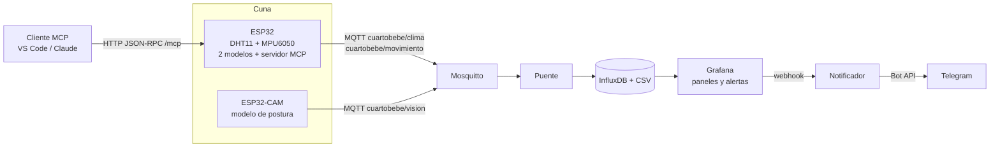

# Actividad 4: modelo de IA en un microcontrolador

**Especialización en Inteligencia Artificial aplicada a Internet de las Cosas**
**Universidad Autónoma de Occidente**

> Documento en construcción. Cada sección marca su responsable y su estado.

---

## 1. Caso de análisis

**Cuarto del bebé inteligente**, el mismo caso de las prácticas 1 a 3, ahora con
inferencia en el dispositivo:

| Fuente | Modelo en el dispositivo | Clases | Alerta |
|---|---|---|---|
| DHT11 (temperatura y humedad) | Clasificación del ambiente | `confort`, `riesgo_leve`, `riesgo` | `riesgo` |
| MPU6050 en la cuna (acelerómetro y giroscopio) | Clasificación de movimiento | `quieto`, `normal`, `agitacion` | `agitacion` sostenida |
| ESP32-CAM sobre la cuna | Clasificación de imagen | `boca_arriba`, `de_lado`, `boca_abajo`, `vacia` | `boca_abajo` (crítica), `de_lado` (advertencia) |

Rango de confort: 18–22 °C y 40–60 % de humedad relativa.

El dataset de imágenes se toma con **un muñeco**, nunca con un bebé real. Es un
prototipo académico: no reemplaza la supervisión de un adulto ni es un
dispositivo médico.

## 2. Arquitectura

## 3. Contrato de mensajes MQTT

Todos los mensajes son JSON con prefijo `cuartobebe/`. `confianza` va de 0 a 1.
El broker exige usuario y contraseña (igual que en la Práctica 2).

| Tópico | Quién publica | Cada cuánto | Ejemplo |
|---|---|---|---|
| `cuartobebe/clima` | ESP32 | 10 s | `{"dispositivo":"esp32-cuna","temperatura_c":21.0,"humedad_pct":45.0,"clase":"confort","confianza":0.93}` |
| `cuartobebe/movimiento` | ESP32 | 2 s (una ventana) | `{"dispositivo":"esp32-cuna","clase":"quieto","confianza":0.88,"ax":0.01,"ay":-0.02,"az":0.98,"gx":1.2,"gy":0.9,"gz":1.1}` |
| `cuartobebe/vision` | ESP32-CAM | 2–5 s | `{"dispositivo":"esp32-cam","clase":"boca_arriba","confianza":0.91}` |

Reglas:

- Los nombres de clase van en minúscula y sin tildes, exactamente como en la tabla
  de la sección 1.
- `ax`, `ay`, `az` (promedio de la ventana, en g) y `gx`, `gy`, `gz` (RMS de la ventana,
  en °/s) son opcionales, pero el panel los necesita.
- El puente descarta los mensajes que no cumplen el contrato y lo anota en su log.
- Una alerta se confirma con 3 predicciones seguidas de la misma clase y confianza de al
  menos 0.8 (`ALERTA_REPETICIONES` y `ALERTA_CONFIANZA`). Lo hace el puente, no la placa.
- Los datos simulados usan dispositivos terminados en `-sim`; las evidencias deben ser de
  `esp32-cuna` y `esp32-cam`.
- Si un modelo aún no existe, la placa publica `"clase":"sin_modelo","confianza":0`
  para poder probar el resto del sistema.

## 4. Servidor MCP en el ESP32

- Endpoint: `http://cuarto-bebe.local/mcp` o `http://<ip-del-esp32>/mcp`, JSON-RPC 2.0 por
  HTTP POST. Código: `firmware/esp32_edge_ai/servidor_mcp.h`.
- Versiones: 2026-07-28 (`server/discover`, sin `initialize`) y las anteriores
  (`initialize`, `ping`). Ambas con `tools/list` y `tools/call`.
- Herramientas, todas de solo lectura:

| Herramienta | Devuelve |
|---|---|
| `leer_ambiente` | Temperatura, humedad y clase del ambiente |
| `leer_movimiento` | Última clase de movimiento y su confianza |
| `leer_postura` | Última postura recibida de la ESP32-CAM |
| `estado_general` | Resumen de las tres y si hay una alerta activa |

El cliente MCP debe estar en la misma red Wi-Fi que el ESP32. Un dato con más de 60 s se
informa como antiguo, para no dar por bueno un cuarto que dejó de medirse. `MCP_TOKEN`
activa una clave opcional.

## 5. Estado y responsables

| Parte | Responsable | Estado |
|---|---|---|
| Firmware principal, DHT11 y modelo de ambiente | Nicolás | Firmware base listo, sin probar en la placa. Faltan datos reales y reentrenar |
| MPU6050 y modelo de movimiento | Nicolás | Lectura y ventana listas. Faltan datos y modelo de Edge Impulse |
| ESP32-CAM, dataset en Roboflow y modelo de postura | Juan Manuel y Julio César | Firmware base y captura listos. Faltan fotos y modelo |
| Puente, Grafana, Telegram, MCP y documentación | Sebastián | Probado con simuladores. Faltan el bot real y la placa |

## 6. Inconvenientes y soluciones

| Inconveniente | Solución |
|---|---|
| Dos bibliotecas Arduino de Edge Impulse chocan en el mismo firmware (archivos y símbolos con el mismo nombre) | El modelo de ambiente va en C puro, generado por `entrenar-ambiente`; Edge Impulse queda para el movimiento |
| La especificación MCP 2026-07-28 eliminó `initialize` y muchos clientes aún lo usan | El servidor atiende las dos generaciones en el mismo endpoint |
| Una imagen o ventana suelta podía disparar una alarma | El puente confirma la clase con 3 predicciones seguidas |
| La clase como etiqueta de InfluxDB separaba las series y la alerta no veía el cambio | La clase y el nivel se guardan como campos |
| El servidor MCP simulado respondía sin leer el cuerpo y Windows cortaba la conexión | Se lee el cuerpo antes de responder |
| En el primer arranque, Grafana envió alertas antes de aplicar la política de avisos | Esperar un minuto tras levantar el stack |

_Pendiente: los que aparezcan con las placas y los modelos._

## 7. Resultados

### 7.1 Plataforma (probada con simuladores, 24 de noviembre de 2026)

| Prueba | Resultado |
|---|---|
| Simulador HTTP contra la API, con y sin `X-API-Key` | 201 con clave; 401 sin ella |
| Simulador MQTT contra Mosquitto, con clave incorrecta | Rechazado (`Not authorized`) |
| Predicciones en InfluxDB, `predicciones.csv` y panel | Guardadas y visibles |
| Alertas `boca_abajo`, `agitacion` y ambiente en `riesgo` | `firing` y `resolved` |
| Aviso por Telegram | Recibido en un servidor de prueba; **falta el bot real** |
| Servidor MCP simulado con el SDK oficial 2.3.0 | HTTP en 2025-11-25 y 2026-07-28; stdio (`mcp-puente`) en 2025-11-25 |
| Lógica MCP del firmware contra la de Python | 570 casos iguales, compilada en PC |
| Modelo de ambiente en C contra Python | 3000 puntos iguales |
| Firmware ESP32 y ESP32-CAM | Compila en PC con bibliotecas simuladas; **falta compilarlo y probarlo en las placas** |

### 7.2 Modelos

_Pendiente: exactitud, matriz de confusión y ejemplos de cada modelo con datos reales._
Las métricas de `modelos/ambiente/` son de **datos sintéticos** y no deben presentarse
como resultado.

## 8. Conclusiones

_Pendiente._
