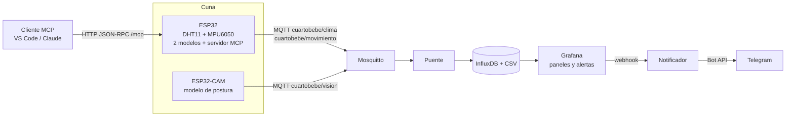

# Actividad 4: modelo de IA en un microcontrolador

**Especialización en Inteligencia Artificial aplicada a Internet de las Cosas**
**Universidad Autónoma de Occidente**

> Documento en construcción. Cada sección marca su responsable y su estado.

---

## 1. Caso de análisis

**Cuarto del bebé inteligente**, el mismo caso de las prácticas 1 a 3, ahora con
inferencia en el dispositivo:

| Fuente | Modelo en el dispositivo | Clases | Alerta |
|---|---|---|---|
| DHT11 (temperatura y humedad) | Clasificación del ambiente | `confort`, `riesgo_leve`, `riesgo` | `riesgo` |
| MPU6050 en la cuna (acelerómetro y giroscopio) | Clasificación de movimiento | `quieto`, `normal`, `agitacion` | `agitacion` sostenida |
| ESP32-CAM sobre la cuna | Clasificación de imagen | `boca_arriba`, `de_lado`, `boca_abajo`, `vacia` | `boca_abajo` (crítica), `de_lado` (advertencia) |

Rango de confort: 18–22 °C y 40–60 % de humedad relativa.

El dataset de imágenes se toma con **un muñeco**, nunca con un bebé real. Es un
prototipo académico: no reemplaza la supervisión de un adulto ni es un
dispositivo médico.

## 2. Arquitectura

## 3. Contrato de mensajes MQTT

Todos los mensajes son JSON con prefijo `cuartobebe/`. `confianza` va de 0 a 1.
El broker exige usuario y contraseña (igual que en la Práctica 2).

| Tópico | Quién publica | Cada cuánto | Ejemplo |
|---|---|---|---|
| `cuartobebe/clima` | ESP32 | 10 s | `{"dispositivo":"esp32-cuna","temperatura_c":21.0,"humedad_pct":45.0,"clase":"confort","confianza":0.93}` |
| `cuartobebe/movimiento` | ESP32 | 2 s (una ventana) | `{"dispositivo":"esp32-cuna","clase":"quieto","confianza":0.88,"ax":0.01,"ay":-0.02,"az":0.98}` |
| `cuartobebe/vision` | ESP32-CAM | 2–5 s | `{"dispositivo":"esp32-cam","clase":"boca_arriba","confianza":0.91}` |

Reglas:

- Los nombres de clase van en minúscula y sin tildes, exactamente como en la tabla
  de la sección 1.
- `ax`, `ay`, `az` son opcionales (último promedio de la ventana, en g).
- Si un modelo aún no existe, la placa publica `"clase":"sin_modelo","confianza":0`
  para poder probar el resto del sistema.

## 4. Servidor MCP en el ESP32

- Endpoint: `http://<ip-del-esp32>/mcp`, JSON-RPC 2.0 por HTTP POST.
- Métodos: `initialize`, `tools/list`, `tools/call`.
- Herramientas previstas:

| Herramienta | Devuelve |
|---|---|
| `leer_ambiente` | Temperatura, humedad y clase del ambiente |
| `leer_movimiento` | Última clase de movimiento y su confianza |
| `leer_postura` | Última postura recibida de la ESP32-CAM |
| `estado_general` | Resumen de las tres y si hay una alerta activa |

El cliente MCP debe estar en la misma red Wi-Fi que el ESP32.

## 5. Estado y responsables

| Parte | Responsable | Estado |
|---|---|---|
| Firmware principal, DHT11 y modelo de ambiente | Integrante 1 | Pendiente |
| MPU6050 y modelo de movimiento | Integrante 2 | Pendiente |
| ESP32-CAM, dataset en Roboflow y modelo de postura | Integrante 3 | Pendiente |
| Puente, Grafana, alertas a Telegram, MCP y documentación | Integrante 4 (con apoyo de Claude) | En curso |

## 6. Inconvenientes y soluciones

_Pendiente: se llena durante el desarrollo._

## 7. Resultados

_Pendiente: exactitud, matriz de confusión y ejemplos de cada modelo._

## 8. Conclusiones

_Pendiente._
