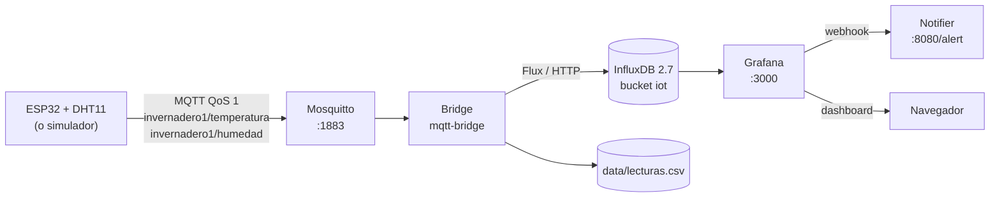

# Práctica 2: Broker MQTT, InfluxDB y Grafana para IoT

**Especialización en Inteligencia Artificial aplicada a Internet de las Cosas**
**Universidad Autónoma de Occidente**

---

## 1. Alcance de esta entrega

| Punto de la guía | Estado | Dónde se implementa |
|---|---|---|
| **4. Almacenamiento de datos en InfluxDB y CSV** | ✅ Implementado y probado | `src/ia_for_iot/mqtt_bridge.py`, `mqtt/docker-compose.yml` |
| **5. Visualización en Grafana con alertas y notificaciones** | ✅ Implementado y probado | `mqtt/grafana/`, `mqtt/notifier/` |
| Broker MQTT (Mosquitto) | ✅ Implementado y probado | `mqtt/mosquitto/` |
| Firmware ESP32 con MQTT | ✅ Implementado y compilado | `firmware/esp32_dht11_mqtt/` |
| Despliegue en AWS (VPC, subred, SG, EC2) | 📄 Documentado (pasos en la sección 8) | — |

La validación de extremo a extremo se realizó en la VM Ubuntu de Vagrant
(Windows 10 + VirtualBox 7.2 + Vagrant 2.4.9), que ejecuta exactamente el mismo
`docker-compose.yml` que se usaría en AWS. No se desplegó en AWS porque el
entorno de trabajo no cuenta con credenciales de esa nube; los pasos quedan
documentados para replicarlo.

---

## 2. Arquitectura



| Servicio | Imagen | Puerto | Credenciales por defecto |
|---|---|---|---|
| `mosquitto` | `eclipse-mosquitto:2` | 1883 | `iot` / `iot2026` |
| `influxdb` | `influxdb:2.7` | 8086 | `admin` / `admin12345` |
| `grafana` | `grafana/grafana-oss:11.6.0` | 3000 | `admin` / `admin` |
| `bridge` | `ia-for-iot:latest` | — | Usa las credenciales MQTT/Influx del entorno |
| `notifier` | `python:3.14-slim` | 8080 (interno) | — |

---

## 3. Punto 4: almacenamiento en InfluxDB y CSV

### 3.1 Flujo

1. El ESP32 (o el simulador) publica `invernadero1/temperatura` y
   `invernadero1/humedad` con QoS 1.
2. `mqtt_bridge.py` se suscribe a `invernadero1/#`, empareja ambas magnitudes
   dentro de una ventana de 60 s (`MQTT_PAIR_TTL`) y descarta pares incompletos.
3. Evalúa los umbrales con `service.evaluar()` (18–22 °C, 40–60 %).
4. Escribe el punto en **InfluxDB** y la fila en **CSV** (doble persistencia).

### 3.2 Esquema en InfluxDB

| Elemento | Valor |
|---|---|
| Bucket | `iot` (org `iaforiot`, retención 30 días) |
| Measurement | `clima` |
| Campos | `temperatura_c`, `humedad_pct`, `alerta` (0/1) |
| Etiquetas | `dispositivo`, `sala`, `estado` |
| Timestamp | Momento de la lectura (UTC) |

### 3.3 Esquema del CSV

```csv
timestamp,dispositivo,temperatura_c,humedad_pct,estado,alerta
2026-10-31T03:23:27.640793Z,esp32-dht11,21.11,54.36,OK,false
2026-10-31T03:23:28.641136Z,esp32-dht11,21.42,53.64,OK,false
2026-10-31T03:23:29.642470Z,esp32-dht11,21.19,54.12,OK,false
```

### 3.4 Evidencia de ejecución

```
$ wc -l data/lecturas.csv
17 data/lecturas.csv

$ docker compose ... logs --tail 8 bridge
Lectura esp32-dht11: 21.16 C / 46.33 % -> OK
Lectura esp32-dht11: 21.72 C / 45.48 % -> OK
Lectura esp32-dht11: 21.11 C / 54.36 % -> OK
Lectura esp32-dht11: 21.42 C / 53.64 % -> OK
Lectura esp32-dht11: 21.19 C / 54.12 % -> OK
```

Consulta Flux sobre InfluxDB (agrupada por estado):

```
$ influx query 'from(bucket:"iot") |> range(start:-1h)
  |> filter(fn: (r) => r._measurement == "clima" and r._field == "temperatura_c")
  |> group(columns: ["estado"]) |> count()'

_result  _value  estado
0        9       ALERTA
1        7       OK
```

Los 16 puntos de InfluxDB coinciden con las 16 filas del CSV (más la cabecera).

---

## 4. Punto 5: visualización y alertas en Grafana

### 4.1 Provisioning automático

Al arrancar, Grafana carga desde `mqtt/grafana/provisioning/`:

- **Datasource** `InfluxDB IoT` (Flux, uid `influxdb-iot`, token de InfluxDB).
- **Dashboard** `IA for IoT - Confort del invernadero` (uid `ia-iot-confort`).
- **Reglas de alerta** en la carpeta `IA for IoT`.
- **Punto de contacto** `Webhook notificador` y su política de notificación.

### 4.2 Dashboard

| Panel | Tipo | Consulta |
|---|---|---|
| Temperatura actual | Stat | Último `temperatura_c` de la última hora |
| Humedad actual | Stat | Último `humedad_pct` de la última hora |
| Estado de confort | Stat | Último `estado` (OK/ALERTA) |
| Temperatura con banda 18–22 °C | Time series | Media por ventana + umbrales |
| Humedad con banda 40–60 % | Time series | Media por ventana + umbrales |

Los cinco paneles se validaron contra la API de Grafana (`/api/ds/query`):
`panel 1..5: OK`.

### 4.3 Reglas de alerta

| Alerta | Condición | Severidad |
|---|---|---|
| Temperatura alta | último valor > 22 °C | critical |
| Temperatura baja | último valor < 18 °C | critical |
| Humedad alta | último valor > 60 % | warning |
| Humedad baja | último valor < 40 % | warning |

Cada regla evalúa la consulta Flux cada 10 s, reduce con `last()` y compara con
el umbral. Se usa `classic_conditions` porque la expresión `threshold` no reduce
series temporales (`only reduced data can be alerted on`).

### 4.4 Notificaciones

Grafana envía los avisos al punto de contacto webhook
`http://notifier:8080/alert`. El notificador:

- Responde `200` a Grafana.
- Escribe una línea legible y el JSON completo en
  `mqtt/notifier/data/notificaciones.log`.
- Imprime el aviso en la salida estándar del contenedor.

También se puede configurar correo electrónico definiendo `GRAFANA_SMTP_*` en
`.env` y añadiendo un contact point de tipo email (no se configuró en la
validación para no requerir credenciales SMTP).

### 4.5 Evidencia de alertas

Lecturas forzadas a 30,5 °C y 80 %:

```powershell
uv run simular-esp32-mqtt --host 127.0.0.1 --user iot --password iot2026 `
  --count 2 --interval 2 --temperatura 30.5 --humedad 80
```

Estado de las reglas 20 s después:

```
Temperatura alta (mas de 22 C) -> firing (ok)   Alerting valor=30.5
Humedad alta (mas de 60 %)     -> firing (ok)   Alerting valor=80
Temperatura baja (menos de 18 C) -> inactive
Humedad baja (menos de 40 %)     -> inactive
```

Registro del notificador:

```
2026-10-31T03:13:45 [firing] [FIRING:1] Temperatura alta (mas de 22 C) IA for IoT (temperatura alta critical)
2026-10-31T03:13:45 [firing] [FIRING:1] Humedad alta (mas de 60 %) IA for IoT (humedad alta warning)
```

Al volver a enviar lecturas normales (≈21 °C / 54 %), las cuatro reglas
volvieron a `inactive`, lo que demuestra el ciclo completo
`firing → resolved`.

---

## 5. Puesta en marcha

### 5.1 Windows con Vagrant (validado)

```powershell
.\scripts\mqtt_vm.ps1          # arranca la VM, sincroniza y construye
.\scripts\mqtt_vm.ps1 -Logs    # logs de los servicios
.\scripts\mqtt_vm.ps1 -Down    # apaga el stack
```

### 5.2 Linux/macOS con Docker

```bash
docker compose -f mqtt/docker-compose.yml up -d --build
```

### 5.3 Verificación rápida

```powershell
uv run simular-esp32-mqtt --host 127.0.0.1 --user iot --password iot2026 --count 20 --interval 1
```

- Grafana: <http://127.0.0.1:3000> (dashboard y alertas).
- InfluxDB: <http://127.0.0.1:8086>.
- Broker: `mqtt://127.0.0.1:1883` con `iot` / `iot2026`.

---

## 6. Firmware ESP32 (MQTT)

`firmware/esp32_dht11_mqtt/esp32_dht11_mqtt.ino`:

- Publica cada 10 s en `invernadero1/temperatura` y `invernadero1/humedad`.
- Reconecta Wi-Fi y MQTT automáticamente.
- Usa PubSubClient 2.8.0 y DHT sensor library 1.4.7.
- Compilación verificada: **68 % de flash** y **14 % de RAM**.

```bash
arduino-cli lib install PubSubClient
arduino-cli compile --fqbn esp32:esp32:esp32 firmware/esp32_dht11_mqtt
arduino-cli upload -p COM3 --fqbn esp32:esp32:esp32 firmware/esp32_dht11_mqtt
```

Ajustes en el sketch: `WIFI_SSID`, `WIFI_PASS`, `MQTT_HOST` (IP LAN del PC con
Vagrant o IP pública de la EC2), `MQTT_USER` y `MQTT_PASS`.

---

## 7. Pruebas y calidad

```bash
uv run pytest -q          # 21 aprobadas (11 API + 10 bridge)
uv run ruff check .       # sin errores
arduino-cli compile ...   # firmware MQTT compila
```

| Prueba | Resultado |
|---|---|
| API de la Práctica 1 | 11/11 |
| Puente MQTT (interpretación, emparejamiento, punto Influx, CSV) | 10/10 |
| Dashboard (5 paneles) | 5/5 consultas válidas |
| Alertas (4 reglas) | `firing` con 30,5 °C / 80 %, `inactive` al normalizar |
| Notificador | Recibe webhook y escribe `notificaciones.log` |
| Firmware MQTT | Compila (68 % flash, 14 % RAM) |

---

## 8. Despliegue en AWS (pasos documentados)

> Estos comandos son una referencia; no se ejecutaron porque el entorno no
> tiene credenciales de AWS. Los nombres y la región son ejemplos
> (`us-east-1`). Sustituye los identificadores por los que devuelva cada
> comando.

### 8.1 Crear la VPC y la subred pública

```bash
# VPC 10.0.0.0/16
aws ec2 create-vpc --cidr-block 10.0.0.0/16 --tag-specifications \
  'ResourceType=vpc,Tags=[{Key=Name,Value=ia-for-iot-vpc}]'

# Subred pública 10.0.1.0/24
aws ec2 create-subnet --vpc-id <VPC_ID> --cidr-block 10.0.1.0/24 \
  --availability-zone us-east-1a --tag-specifications \
  'ResourceType=subnet,Tags=[{Key=Name,Value=ia-for-iot-publica}]'
```

En la consola: **VPC → Crear VPC → VPC y más → con subred pública**, CIDR
`10.0.0.0/16`, subred `10.0.1.0/24`.

### 8.2 Internet Gateway y tabla de rutas

```bash
aws ec2 create-internet-gateway --tag-specifications \
  'ResourceType=internet-gateway,Tags=[{Key=Name,Value=ia-for-iot-igw}]'
aws ec2 attach-internet-gateway --vpc-id <VPC_ID> --internet-gateway-id <IGW_ID>

aws ec2 create-route-table --vpc-id <VPC_ID> --tag-specifications \
  'ResourceType=route-table,Tags=[{Key=Name,Value=ia-for-iot-rt}]'
aws ec2 create-route --route-table-id <RT_ID> \
  --destination-cidr-block 0.0.0.0/0 --gateway-id <IGW_ID>
aws ec2 associate-route-table --route-table-id <RT_ID> --subnet-id <SUBNET_ID>
```

La subred debe tener **asignación automática de IP pública** activada
(consola: Subred → Acciones → Editar atributos de subred).

### 8.3 Security Group

| Puerto | Protocolo | Origen | Uso |
|---|---|---|---|
| 22 | TCP | Tu IP | SSH |
| 8080 | TCP | 0.0.0.0/0 (o tu IP) | API de la Práctica 1 |
| 1883 | TCP | 0.0.0.0/0 | MQTT (idealmente TLS 8883) |
| 3000 | TCP | Tu IP | Grafana |
| 8086 | TCP | Tu IP | InfluxDB (solo administración) |

```bash
aws ec2 create-security-group --group-name ia-for-iot-sg \
  --description "Practica 2 IoT" --vpc-id <VPC_ID>

aws ec2 authorize-security-group-ingress --group-id <SG_ID> \
  --ip-permissions \
  'IpProtocol=tcp,FromPort=22,ToPort=22,IpRanges=[{CidrIp=TU_IP/32}]' \
  'IpProtocol=tcp,FromPort=8080,ToPort=8080,IpRanges=[{CidrIp=0.0.0.0/0}]' \
  'IpProtocol=tcp,FromPort=1883,ToPort=1883,IpRanges=[{CidrIp=0.0.0.0/0}]' \
  'IpProtocol=tcp,FromPort=3000,ToPort=3000,IpRanges=[{CidrIp=TU_IP/32}]' \
  'IpProtocol=tcp,FromPort=8086,ToPort=8086,IpRanges=[{CidrIp=TU_IP/32}]'
```

> El Security Group es el control real de acceso. `ufw` dentro de la instancia
> no filtra el tráfico de los puertos publicados por Docker (Docker inserta sus
> propias reglas de iptables).

### 8.4 Crear la instancia EC2

```bash
# AMI más reciente de Ubuntu 22.04
aws ec2 describe-images --owners 099720109477 \
  --filters 'Name=name,Values=ubuntu/images/hvm-ssd/ubuntu-jammy-22.04-amd64-server-*' \
  --query 'sort_by(Images,&CreationDate)[-1].ImageId' --output text

aws ec2 create-key-pair --key-name ia-for-iot-key \
  --query 'KeyMaterial' --output text > ia-for-iot-key.pem

aws ec2 run-instances --image-id <AMI_ID> --instance-type t3.small \
  --key-name ia-for-iot-key --security-group-ids <SG_ID> \
  --subnet-id <SUBNET_ID> --block-device-mappings \
  'DeviceName=/dev/sda1,Ebs={VolumeSize=20,VolumeType=gp3}' \
  --tag-specifications 'ResourceType=instance,Tags=[{Key=Name,Value=ia-for-iot}]'
```

`t3.small` (2 vCPU, 2 GB) es el mínimo recomendado para los cinco contenedores.
`t3.micro` (1 GB) puede quedarse sin memoria al compilar la imagen.

### 8.5 Instalar Docker y desplegar

```bash
ssh -i ia-for-iot-key.pem ubuntu@<IP_PUBLICA>

sudo apt update && sudo apt install -y ca-certificates curl git
curl -fsSL https://get.docker.com | sudo sh
sudo usermod -aG docker ubuntu
newgrp docker

git clone https://github.com/juano2024/IA_for_IoT.git
cd IA_for_IoT
docker compose -f mqtt/docker-compose.yml up -d --build
```

Comprobaciones:

```bash
docker compose -f mqtt/docker-compose.yml ps
curl http://127.0.0.1:3000/api/health
curl http://127.0.0.1:8086/health
```

### 8.6 Elastic IP y firmware

```bash
aws ec2 allocate-address --domain vpc
aws ec2 associate-address --instance-id <INSTANCE_ID> --allocation-id <EIP_ID>
```

Actualiza `MQTT_HOST` en `firmware/esp32_dht11_mqtt/esp32_dht11_mqtt.ino` con
la IP elástica y vuelve a cargar el sketch.

### 8.7 Endurecimiento recomendado

1. **TLS en MQTT** (puerto 8883) con certificados de Let's Encrypt y
   `allow_anonymous false`.
2. **Proxy inverso** (Caddy o Nginx) delante de Grafana con HTTPS.
3. **Token de InfluxDB de solo lectura** para Grafana; no reutilizar el token
   de administración.
4. Contraseñas fuertes en `.env` (Mosquitto, InfluxDB, Grafana).
5. Copias de seguridad: `influx backup /ruta/backup` y snapshot del volumen
   `influxdb-data`.
6. CloudWatch para CPU, disco y estado de la instancia.

### 8.8 Costos aproximados (us-east-1)

| Recurso | Costo aproximado |
|---|---|
| `t3.small` 24/7 | ~15 USD/mes |
| EBS gp3 20 GB | ~1,6 USD/mes |
| Elastic IP asociada | 0 USD |
| Transferencia saliente | ~0,09 USD/GB |

> `t3.small` no entra en la capa gratuita (solo `t2.micro`/`t3.micro`).

---

## 9. Estructura de los archivos nuevos

```
mqtt/
├── docker-compose.yml                  # Mosquitto, InfluxDB, Grafana, bridge y notifier
├── mosquitto/
│   ├── mosquitto.conf                  # Autenticación obligatoria
│   └── entrypoint.sh                   # Genera el archivo de usuarios
├── grafana/
│   ├── dashboards/confort.json         # Dashboard de 5 paneles
│   └── provisioning/
│       ├── datasources/influxdb.yml
│       ├── dashboards/dashboards.yml
│       └── alerting/
│           ├── alert-rules.yml         # 4 reglas
│           ├── contact-points.yml      # Webhook al notificador
│           └── notification-policies.yml
└── notifier/notifier.py                # Receptor HTTP de alertas

src/ia_for_iot/
├── mqtt_bridge.py                      # MQTT -> InfluxDB + CSV
└── publicador_mqtt.py                  # Simulador (simular-esp32-mqtt)

tests/test_mqtt_bridge.py               # 10 pruebas
firmware/esp32_dht11_mqtt/              # Sketch MQTT del ESP32
scripts/mqtt_vm.ps1                     # Despliegue del stack en la VM
```

---

## 10. Limitaciones y trabajo futuro

- La validación se hizo con el simulador MQTT; no había ESP32 físico
  disponible. El sketch compila y replica el mismo contrato de topics.
- El despliegue en AWS quedó documentado, no ejecutado.
- Las notificaciones por correo requieren credenciales SMTP del proveedor.
- Para producción: TLS en MQTT/Grafana, alta disponibilidad de InfluxDB y
  retención por capas (downsampling).
