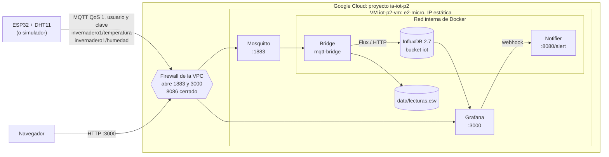

# Práctica 2: Broker MQTT, InfluxDB y Grafana para IoT

**Especialización en Inteligencia Artificial aplicada a Internet de las Cosas**
**Universidad Autónoma de Occidente**

---

## 1. Alcance de esta entrega

**Caso de uso:** condiciones del cultivo de tomate en invernadero. El rango
óptimo es de 15–30 °C y 60–80 % de humedad relativa; por debajo de 12–15 °C y
por encima de 30–35 °C hay problemas de desarrollo y fructificación (fuente:
Infoagro, [*El cultivo del tomate*](https://www.infoagro.com/documentos/el_cultivo_del_tomate__parte_i_.asp)).

| Punto de la guía | Estado | Dónde se implementa |
|---|---|---|
| **2. Máquina virtual en la nube con broker MQTT** | ✅ Implementado (Google Cloud) | `scripts/gcp_practica2.ps1`, `deploy/gcp_mqtt_startup.sh` |
| **3. ESP32 con usuario y contraseña; grupo de seguridad** | ✅ Implementado | `firmware/esp32_dht11_mqtt/`, reglas de firewall (sección 8.3) |
| **6. Base de datos separada de Internet** | ✅ Implementado | `mqtt/docker-compose.gcp.yml` (InfluxDB sin puerto publicado) |
| **4. Almacenamiento de datos en InfluxDB y CSV** | ✅ Implementado y probado | `src/ia_for_iot/mqtt_bridge.py`, `mqtt/docker-compose.yml` |
| **5. Visualización en Grafana con alertas y notificaciones** | ✅ Implementado y probado | `mqtt/grafana/`, `mqtt/notifier/` |
| Broker MQTT (Mosquitto) | ✅ Implementado y probado | `mqtt/mosquitto/` |
| Firmware ESP32 con MQTT | ✅ Implementado y compilado | `firmware/esp32_dht11_mqtt/` |

La validación de extremo a extremo se hizo primero en la VM Ubuntu de Vagrant
(Windows 10 + VirtualBox 7.2 + Vagrant 2.4.9) y después con Docker Desktop,
con el mismo override que se usa en la nube. El despliegue se hace en Google
Cloud (sección 8), con la aprobación del profesor.

---

## 2. Arquitectura



InfluxDB no publica ningún puerto en la nube: solo el puente y Grafana lo
alcanzan por la red interna de Docker. Así se cumple el punto 6 de la guía
(base de datos separada de Internet) sin una segunda VM.

| Servicio | Imagen | Puerto | Credenciales en local (en GCP se generan claves aleatorias) |
|---|---|---|---|
| `mosquitto` | `eclipse-mosquitto:2` | 1883 | `iot` / `iot2026` |
| `influxdb` | `influxdb:2.7` | 8086 | `admin` / `admin12345` |
| `grafana` | `grafana/grafana-oss:11.6.0` | 3000 | `admin` / `admin` |
| `bridge` | `ia-for-iot:latest` | — | Usa las credenciales MQTT/Influx del entorno |
| `notifier` | `python:3.14-slim` | 8080 (interno) | — |

---

## 3. Punto 4: almacenamiento en InfluxDB y CSV

### 3.1 Flujo

1. El ESP32 (o el simulador) publica `invernadero1/temperatura` y
   `invernadero1/humedad` con QoS 1.
2. `mqtt_bridge.py` se suscribe a `invernadero1/#`, empareja ambas magnitudes
   dentro de una ventana de 60 s (`MQTT_PAIR_TTL`) y descarta pares incompletos.
3. Evalúa los umbrales con `service.evaluar()` (15–30 °C, 60–80 %).
4. Escribe el punto en **InfluxDB** y la fila en **CSV** (doble persistencia).

### 3.2 Esquema en InfluxDB

| Elemento | Valor |
|---|---|
| Bucket | `iot` (org `iaforiot`, retención 30 días) |
| Measurement | `clima` |
| Campos | `temperatura_c`, `humedad_pct`, `alerta` (0/1) |
| Etiquetas | `dispositivo`, `sala`, `estado` |
| Timestamp | Momento de la lectura (UTC) |

### 3.3 Esquema del CSV

```csv
timestamp,dispositivo,temperatura_c,humedad_pct,estado,alerta
2026-10-31T03:23:27.640793Z,esp32-dht11,21.11,54.36,OK,false
2026-10-31T03:23:28.641136Z,esp32-dht11,21.42,53.64,OK,false
2026-10-31T03:23:29.642470Z,esp32-dht11,21.19,54.12,OK,false
```

### 3.4 Evidencia de ejecución

```
$ wc -l data/lecturas.csv
17 data/lecturas.csv

$ docker compose ... logs --tail 8 bridge
Lectura esp32-dht11: 21.16 C / 46.33 % -> OK
Lectura esp32-dht11: 21.72 C / 45.48 % -> OK
Lectura esp32-dht11: 21.11 C / 54.36 % -> OK
Lectura esp32-dht11: 21.42 C / 53.64 % -> OK
Lectura esp32-dht11: 21.19 C / 54.12 % -> OK
```

Consulta Flux sobre InfluxDB (agrupada por estado):

```
$ influx query 'from(bucket:"iot") |> range(start:-1h)
  |> filter(fn: (r) => r._measurement == "clima" and r._field == "temperatura_c")
  |> group(columns: ["estado"]) |> count()'

_result  _value  estado
0        9       ALERTA
1        7       OK
```

Los 16 puntos de InfluxDB coinciden con las 16 filas del CSV (más la cabecera).

---

## 4. Punto 5: visualización y alertas en Grafana

### 4.1 Provisioning automático

Al arrancar, Grafana carga desde `mqtt/grafana/provisioning/`:

- **Datasource** `InfluxDB IoT` (Flux, uid `influxdb-iot`, token de InfluxDB).
- **Dashboard** `IA for IoT - Confort del invernadero` (uid `ia-iot-confort`).
- **Reglas de alerta** en la carpeta `IA for IoT`.
- **Punto de contacto** `Webhook notificador` y su política de notificación.

### 4.2 Dashboard

| Panel | Tipo | Consulta |
|---|---|---|
| Temperatura actual | Stat | Último `temperatura_c` de la última hora |
| Humedad actual | Stat | Último `humedad_pct` de la última hora |
| Estado de confort | Stat | Último `estado` (OK/ALERTA) |
| Temperatura con banda 15–30 °C | Time series | Media por ventana + umbrales |
| Humedad con banda 60–80 % | Time series | Media por ventana + umbrales |

Los cinco paneles se validaron contra la API de Grafana (`/api/ds/query`):
cada uno devuelve una sola serie con el último valor publicado.

### 4.3 Reglas de alerta

| Alerta | Condición | Severidad |
|---|---|---|
| Temperatura alta | último valor > 30 °C | critical |
| Temperatura baja | último valor < 15 °C | critical |
| Humedad alta | último valor > 80 % | warning |
| Humedad baja | último valor < 60 % | warning |

Cada regla evalúa la consulta Flux cada 10 s, reduce con `last()` y compara con
el umbral. Se usa `classic_conditions` porque la expresión `threshold` no reduce
series temporales (`only reduced data can be alerted on`).

Antes de `last()`, las consultas de alertas y paneles conservan solo `_time`,
`_value`, `_field` y `dispositivo`, y agrupan por dispositivo. Sin ese paso, la
etiqueta `estado` separaba los datos en una serie OK y otra ALERTA: `last()`
devolvía el último valor de cada una y la alerta seguía disparada hasta 5
minutos después de normalizarse la lectura.

### 4.4 Notificaciones

Grafana envía los avisos al punto de contacto webhook
`http://notifier:8080/alert`. El notificador:

- Responde `200` a Grafana.
- Escribe una línea legible y el JSON completo en
  `mqtt/notifier/data/notificaciones.log`.
- Imprime el aviso en la salida estándar del contenedor.

También se puede configurar correo electrónico definiendo `GRAFANA_SMTP_*` en
`.env` y añadiendo un contact point de tipo email (no se configuró en la
validación para no requerir credenciales SMTP).

### 4.5 Evidencia de alertas

Validación con Docker Desktop y el override de GCP (31 de octubre de 2026).
Lecturas forzadas a 12 °C y 85 %, y luego normales a 24 °C y 70 %:

```powershell
uv run simular-esp32-mqtt --host 127.0.0.1 --user iot --password <clave> `
  --count 2 --interval 1 --temperatura 12 --humedad 85
uv run simular-esp32-mqtt --host 127.0.0.1 --user iot --password <clave> `
  --count 2 --interval 1 --temperatura 24 --humedad 70
```

Estado de las reglas 25 s después de cada envío:

```
fuera de rango: Temperatura alta=inactive, Temperatura baja=firing, Humedad alta=firing, Humedad baja=inactive
normal:         Temperatura alta=inactive, Temperatura baja=inactive, Humedad alta=inactive, Humedad baja=inactive
```

Registro del notificador:

```
2026-10-31T12:15:15 [firing] [FIRING:1] Humedad alta (mas de 80 %) IA for IoT (humedad alta warning)
2026-10-31T12:15:17 [firing] [FIRING:1] Temperatura baja (menos de 15 C) IA for IoT (temperatura baja critical)
2026-10-31T12:15:45 [resolved] [RESOLVED] Humedad alta (mas de 80 %) IA for IoT (humedad alta warning)
2026-10-31T12:15:47 [resolved] [RESOLVED] Temperatura baja (menos de 15 C) IA for IoT (temperatura baja critical)
```

El ciclo `firing → resolved` se completa en unos 30 s. En la misma prueba, el
broker rechazó las conexiones sin clave y con clave errada (`Not authorized`).

---

## 5. Puesta en marcha

### 5.1 Windows con Vagrant (validado)

```powershell
.\scripts\mqtt_vm.ps1          # arranca la VM, sincroniza y construye
.\scripts\mqtt_vm.ps1 -Logs    # logs de los servicios
.\scripts\mqtt_vm.ps1 -Down    # apaga el stack
```

### 5.2 Linux/macOS con Docker

```bash
docker compose -f mqtt/docker-compose.yml up -d --build
```

### 5.3 Verificación rápida

```powershell
uv run simular-esp32-mqtt --host 127.0.0.1 --user iot --password iot2026 --count 20 --interval 1
```

- Grafana: <http://127.0.0.1:3000> (dashboard y alertas).
- InfluxDB: <http://127.0.0.1:8086>.
- Broker: `mqtt://127.0.0.1:1883` con `iot` / `iot2026`.

---

## 6. Firmware ESP32 (MQTT)

`firmware/esp32_dht11_mqtt/esp32_dht11_mqtt.ino`:

- Publica cada 10 s en `invernadero1/temperatura` y `invernadero1/humedad`.
- Reconecta Wi-Fi y MQTT automáticamente.
- Usa PubSubClient 2.8.0 y DHT sensor library 1.4.7.
- Compilación verificada: **68 % de flash** y **14 % de RAM**.

```bash
arduino-cli lib install PubSubClient
arduino-cli compile --fqbn esp32:esp32:esp32 firmware/esp32_dht11_mqtt
arduino-cli upload -p COM3 --fqbn esp32:esp32:esp32 firmware/esp32_dht11_mqtt
```

Ajustes en el sketch: `WIFI_SSID`, `WIFI_PASS`, `MQTT_HOST` (IP LAN del PC con
Vagrant o IP externa de la VM en Google Cloud), `MQTT_USER` y `MQTT_PASS`. En el
repositorio quedan como marcadores; los valores reales se comparten por un
canal privado.

---

## 7. Pruebas y calidad

```bash
uv run pytest -q          # 22 aprobadas (11 API + 11 bridge)
uv run ruff check .       # sin errores
arduino-cli compile ...   # firmware MQTT compila
```

| Prueba | Resultado |
|---|---|
| API de la Práctica 1 | 11/11 |
| Puente MQTT (interpretación, emparejamiento, punto Influx, CSV, falla de Influx) | 11/11 |
| Dashboard (5 paneles) | 5/5 consultas válidas |
| Alertas (4 reglas) | `firing` con 12 °C / 85 %, `resolved` al normalizar (unos 30 s) |
| Notificador | Recibe webhook y escribe `notificaciones.log` |
| Firmware MQTT | Compila (68 % flash, 14 % RAM) |

---

## 8. Despliegue en Google Cloud

El profesor aprobó usar Google Cloud en lugar de AWS. Todo se crea con
`scripts/gcp_practica2.ps1` en un proyecto exclusivo para esta práctica, que
se elimina al terminar. La VM es `e2-micro`, que entra en la capa gratuita.

### 8.1 Equivalencias AWS ↔ GCP

| Lo que pide la guía (AWS) | Implementación en Google Cloud |
|---|---|
| Instancia EC2 | VM de Compute Engine `iot-p2-vm`, `e2-micro`, Ubuntu 22.04, `us-central1-a` |
| Elastic IP | IP externa estática `iot-p2-ip` |
| Security Group | Reglas de firewall de la VPC sobre la etiqueta de red `iot-p2` |
| Base de datos separada | InfluxDB sin puerto publicado: solo existe en la red interna de Docker de la VM y ninguna regla de firewall la expone |
| User data | Startup script en los metadatos de la VM (`deploy/gcp_mqtt_startup.sh`) |
| Key pair y SSH | `gcloud compute ssh` por IAP, sin SSH abierto a Internet |

Google Cloud no tiene un servicio administrado equivalente a AWS IoT Core
(Cloud IoT Core se retiró en 2023). Por eso el broker es Mosquitto propio en la
VM, el patrón que Google describe en su arquitectura de
[broker MQTT independiente](https://docs.cloud.google.com/architecture/connected-devices/mqtt-broker-architecture).

### 8.2 Desplegar

```powershell
gcloud auth login                      # cuenta con acceso a la facturación
.\scripts\gcp_practica2.ps1 -Up -ProjectId ia-iot-p2-2026 -BillingAccount <ID_FACTURACION>
.\scripts\gcp_practica2.ps1 -Status -ProjectId ia-iot-p2-2026
```

`-Up` es idempotente y hace, en orden:

1. Crea el proyecto, lo vincula a la cuenta de facturación y habilita
   Compute Engine e IAP.
2. Reserva la IP externa estática en `us-central1`.
3. Crea las reglas de firewall de la sección 8.3 y borra `default-allow-ssh`
   y `default-allow-rdp`.
4. Genera claves aleatorias en `.env.gcp` (ignorado por git), si no existen.
5. Crea la VM con disco estándar de 20 GB, la etiqueta `iot-p2`, el startup
   script y las claves en los metadatos.

### 8.3 Firewall

| Regla | Puertos | Origen | Uso |
|---|---|---|---|
| `iot-p2-mqtt-grafana` | TCP 1883, 3000 | `0.0.0.0/0` | ESP32 de los compañeros y panel de Grafana |
| `iot-p2-ssh-iap` | TCP 22 | `35.235.240.0/20` | SSH solo a través de IAP |
| Ninguna | TCP 8086 | — | InfluxDB queda cerrado a Internet |

El firewall de la VPC filtra fuera de la VM, así que también se aplica a los
puertos que publica Docker.

### 8.4 Startup script

[`deploy/gcp_mqtt_startup.sh`](deploy/gcp_mqtt_startup.sh) se ejecuta en cada
arranque y nunca borra datos:

1. Instala Docker Engine y Docker Compose si faltan.
2. Crea 2 GB de intercambio para construir la imagen en la `e2-micro`.
3. Clona la rama `practica-2-mqtt` en `/opt/ia_for_iot` o la actualiza.
4. Escribe `mqtt/.env` (permiso 600) con las claves de los metadatos.
5. Levanta el stack con el override
   [`mqtt/docker-compose.gcp.yml`](mqtt/docker-compose.gcp.yml) y espera a
   que Grafana responda.

El override quita la publicación del 8086, exige las contraseñas (sin valores
por defecto) y desactiva el acceso anónimo a Grafana. Los datos viven en
volúmenes de Docker con nombre y en `data/`, que git no toca.

### 8.5 Claves

| Clave | Quién la usa |
|---|---|
| `MQTT_USERNAME` / `MQTT_PASSWORD` | ESP32, simulador y MQTT Explorer |
| `GRAFANA_ADMIN_PASSWORD` | Acceso al panel (`admin`) |
| `INFLUX_ADMIN_PASSWORD` / `INFLUX_TOKEN` | Solo dentro de la VM (puente y Grafana) |

Se comparten con el equipo por un canal privado. Nunca se suben al
repositorio ni se escriben en el firmware publicado.

### 8.6 Verificación

```powershell
# Desde el PC: publicar en el broker de la nube
uv run simular-esp32-mqtt --host <IP> --user iot --password <MQTT_PASSWORD> --count 5 --interval 2

# Sin clave, el broker debe rechazar la conexión
uv run simular-esp32-mqtt --host <IP> --count 1

# InfluxDB no debe responder desde Internet
Test-NetConnection <IP> -Port 8086
```

Dentro de la VM (`gcloud compute ssh iot-p2-vm --tunnel-through-iap`):

```bash
cd /opt/ia_for_iot
sudo docker compose -f mqtt/docker-compose.yml -f mqtt/docker-compose.gcp.yml ps
wc -l data/lecturas.csv
sudo tail -n 5 mqtt/notifier/data/notificaciones.log
```

### 8.7 Costos

| Recurso | Costo |
|---|---|
| VM `e2-micro` | US$0: una `e2-micro` al mes es gratuita en `us-central1`, `us-west1` o `us-east1` |
| Disco estándar de 20 GB | US$0 dentro de los 30 GB-mes gratuitos |
| IP externa en uso | US$0.005 por hora (unos US$0.12 al día) |
| Tráfico saliente | 1 GB al mes gratuito desde Norteamérica |

Fuentes: [capa gratuita de Google Cloud](https://docs.cloud.google.com/free/docs/free-cloud-features)
y [precio de las IP externas](https://cloud.google.com/vpc/pricing-announce-external-ips).
En la validación local los cinco contenedores usaron unos 250 MB de memoria,
por lo que caben en el 1 GB de la `e2-micro`.

### 8.8 Desmontaje

```powershell
.\scripts\gcp_practica2.ps1 -Down -ProjectId ia-iot-p2-2026
gcloud projects describe ia-iot-p2-2026 --format "value(lifecycleState)"   # DELETE_REQUESTED
```

Borrar el proyecto elimina la VM, el disco, la IP y las reglas de firewall, y
detiene todos los cobros. El script solo acepta proyectos `ia-iot-p2-*`.

### 8.9 Endurecimiento recomendado

1. **TLS en MQTT** (puerto 8883) y certificados en el ESP32.
2. **Proxy inverso** (Caddy o Nginx) delante de Grafana con HTTPS.
3. **Token de InfluxDB de solo lectura** para Grafana.
4. Copias de seguridad: `influx backup` y snapshot del disco.
5. Cloud Monitoring para CPU, memoria y disco de la VM.

---

## 9. Estructura de los archivos nuevos

```
mqtt/
├── docker-compose.yml                  # Mosquitto, InfluxDB, Grafana, bridge y notifier
├── docker-compose.gcp.yml              # Override de GCP: InfluxDB interno y claves obligatorias
├── .env.example                        # Claves y rangos del stack
├── mosquitto/
│   ├── mosquitto.conf                  # Autenticación obligatoria
│   └── entrypoint.sh                   # Genera el archivo de usuarios
├── grafana/
│   ├── dashboards/confort.json         # Dashboard de 5 paneles
│   └── provisioning/
│       ├── datasources/influxdb.yml
│       ├── dashboards/dashboards.yml
│       └── alerting/
│           ├── alert-rules.yml         # 4 reglas
│           ├── contact-points.yml      # Webhook al notificador
│           └── notification-policies.yml
└── notifier/notifier.py                # Receptor HTTP de alertas

src/ia_for_iot/
├── mqtt_bridge.py                      # MQTT -> InfluxDB + CSV
└── publicador_mqtt.py                  # Simulador (simular-esp32-mqtt)

tests/test_mqtt_bridge.py               # 10 pruebas
firmware/esp32_dht11_mqtt/              # Sketch MQTT del ESP32
scripts/mqtt_vm.ps1                     # Despliegue del stack en la VM
scripts/gcp_practica2.ps1               # Crea, revisa y borra el despliegue en GCP
deploy/gcp_mqtt_startup.sh              # Startup script de la VM en GCP
```

---

## 10. Limitaciones y trabajo futuro

- La validación local se hizo con el simulador MQTT. El sketch compila y
  replica el mismo contrato de topics.
- El despliegue en Google Cloud es temporal: el proyecto se elimina después
  de tomar las evidencias, para no generar costos.
- MQTT viaja sin TLS: la clave del broker no va cifrada por Internet.
- Las notificaciones llegan al webhook del notificador; por correo requieren
  credenciales SMTP del proveedor.
- Para producción: TLS en MQTT/Grafana, alta disponibilidad de InfluxDB y
  retención por capas (downsampling).

---

## 11. Evidencias en Google Cloud

Despliegue del 31 de octubre de 2026 en el proyecto `ia-iot-p2-uao-1031`,
VM `iot-p2-vm` (`e2-micro`, `us-central1-a`), IP `136.113.16.29`, rama
`practica-2-mqtt`. Salidas completas en
[`docs/evidencias/practica2/`](docs/evidencias/practica2/).

| Comprobación | Resultado | Archivo |
|---|---|---|
| El startup script deja el stack listo | Docker instalado, rama clonada y Grafana respondiendo unos 15 min después de crear la VM | `02_dentro_de_la_vm.txt` |
| Los cinco contenedores en marcha | `mosquitto`, `influxdb` y `notifier` *healthy*; `grafana` y `bridge` arriba | `02_dentro_de_la_vm.txt` |
| Memoria en la `e2-micro` | Unos 190 MB en contenedores; 421 MB usados de 958 MB y 207 MB de intercambio | `02_dentro_de_la_vm.txt` |
| Publicar desde Internet con clave | Lecturas recibidas por el puente | `01_pruebas_desde_internet.txt` |
| Publicar sin clave o con clave errada | Rechazado: `Not authorized` | `01_pruebas_desde_internet.txt` |
| Puertos desde Internet | 1883 y 3000 abiertos; **8086 y 22 cerrados** | `01_pruebas_desde_internet.txt` |
| Doble persistencia | 9 lecturas publicadas: 9 en InfluxDB (3 ALERTA, 6 OK) y 8 en el CSV* | `02_dentro_de_la_vm.txt` |
| Alertas con 33 °C / 50 % | «Temperatura alta» y «Humedad baja» en `firing` | ambos |
| Alertas al normalizar | Las cuatro reglas en `inactive`; el notificador registra `[RESOLVED]` en 1 min | ambos |
| Grafana sin credenciales | `HTTP 401` | `01_pruebas_desde_internet.txt` |
| Actualizar la VM sin perder datos | Al volver a ejecutar el startup script (commit `ed98ccc`), el CSV conservó sus 8 filas | `03_actualizacion_y_paridad.txt` |
| Doble persistencia tras la corrección | 5 lecturas más: el CSV pasó de 8 a 13 y InfluxDB de 9 a 14 | `03_actualizacion_y_paridad.txt` |

\* En la `e2-micro`, la primera escritura en InfluxDB tardó más que el tiempo
de espera del cliente (10 s). InfluxDB guardó el punto, pero el puente lo dio
por fallido y no escribió esa fila en el CSV. Se corrigió en
`src/ia_for_iot/mqtt_bridge.py`: el CSV se escribe primero y el tiempo de
espera pasó a 30 s. La prueba `test_procesar_lectura_guarda_csv_aunque_falle_influx`
cubre el caso.

Pendiente de completar por el equipo antes de eliminar el proyecto:

- [ ] Capturas de MQTT Explorer conectado a `136.113.16.29:1883` con usuario y clave.
- [ ] Monitor Serial del ESP32 real publicando al broker de la nube.
- [ ] Panel de Grafana con datos del ESP32 real y una alerta disparada.
- [ ] Capturas de la consola de GCP: VM, IP estática y reglas de firewall.
