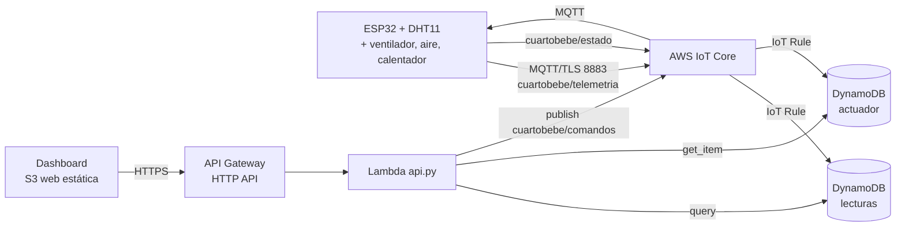

# Práctica 3: Arquitectura serverless para IoT en AWS

**Especialización en Inteligencia Artificial aplicada a Internet de las Cosas**
**Universidad Autónoma de Occidente**

---

## 1. Caso de uso y alcance

**Monitoreo del cuarto de un bebé**, el mismo caso de la Práctica 1. Rangos de
confort: 18–22 °C y 40–60 % de humedad relativa. El sistema climatiza el cuarto
con tres actuadores (relé o LED por cada uno) según qué tan fuera de rango esté
la temperatura:

| Temperatura | Alerta | Actuador | GPIO |
|---|---|---|---|
| 18–22 °C | Confort | Ninguno | — |
| > 22 °C y ≤ 25 °C | Poco calor | **Ventilador** | 26 |
| > 25 °C | Mucho calor | **Aire acondicionado** | 27 |
| < 18 °C | Frío | **Calentador** | 25 |

El ESP32 trabaja en **modo automático** por defecto (decide con estos umbrales y
solo enciende un actuador a la vez). Desde el dashboard se puede pasar a **modo
manual** para encender o apagar cada actuador, y volver a automático. La
humedad fuera de 40–60 % marca `ALERTA` pero no tiene actuador asociado.

| Punto de la guía | Dónde se implementa |
|---|---|
| 1. Caso de uso | Esta sección |
| 2. Servicio AWS IoT | `aws/template.yaml` (Thing, política, reglas), `firmware/esp32_dht11_aws/` |
| 3. Base de datos (DynamoDB) | `aws/template.yaml`: tablas `ia-iot-p3-lecturas` y `ia-iot-p3-actuador` |
| 4. Dashboard con actuador y CSV | `aws/dashboard/index.html`, `aws/lambda/api.py` |
| 5. S3 como web estática | Bucket `WebsiteBucket` de la plantilla |
| 6. GitHub con README y paso a paso | `README.md` (sección 15) y este documento |
| 7. Presentación | Guion en la sección 9 |

## 2. Arquitectura



Flujo de datos:

1. El ESP32 lee el DHT11 cada 10 s y publica JSON en `cuartobebe/telemetria`
   con autenticación mutua TLS (certificado X.509 del dispositivo).
2. La regla `ia_iot_p3_telemetria` guarda cada mensaje en DynamoDB
   (clave `dispositivo` + `ts` en milisegundos).
3. El dashboard consulta `GET /api/lecturas`; la Lambda calcula `OK`/`ALERTA`
   con los rangos del bebé y el actuador recomendado.
4. En modo automático, el ESP32 enciende el ventilador, el aire o el calentador
   según la temperatura. Los botones del dashboard llaman a `POST /api/actuador`;
   la Lambda publica en `cuartobebe/comandos`, el ESP32 lo aplica y publica en
   `cuartobebe/estado` el modo y el estado de los tres actuadores, que otra
   regla guarda en la tabla `actuador`.
5. `GET /api/lecturas.csv` descarga hasta 10 000 lecturas en CSV.

## 3. Recursos de AWS

| Recurso | Nombre | Notas |
|---|---|---|
| IoT Thing / política | `ia-iot-p3-esp32`, `ia-iot-p3-device-policy` | Solo `Connect` como `esp32-dht11`, `Publish` en `telemetria` y `estado`, `Subscribe`/`Receive` en `comandos` |
| IoT Rules | `ia_iot_p3_telemetria`, `ia_iot_p3_estado` | Acción `DynamoDBv2` |
| DynamoDB | `ia-iot-p3-lecturas`, `ia-iot-p3-actuador` | Pago por solicitud |
| Lambda | `ia-iot-p3-api` | Python 3.12, una sola función con enrutado interno |
| API Gateway | HTTP API con CORS | Rutas `/api/{proxy+}` |
| S3 | Bucket del dashboard | Web estática con lectura pública (solo el dashboard) |

### API

| Método | Ruta | Descripción |
|---|---|---|
| `GET` | `/api/lecturas?limite=100` | Últimas lecturas, más reciente primero |
| `GET` | `/api/lecturas.csv` | Descarga CSV (`timestamp,dispositivo,temperatura_c,humedad_pct,estado,actuador_sugerido`) |
| `GET` | `/api/actuador` | Modo y estado de ventilador, aire y calentador confirmados por el ESP32 |
| `POST` | `/api/actuador` | `{"actuador":"ventilador\|aire\|calentador","estado":"ON\|OFF"}` o `{"modo":"AUTO"}`; cabecera `x-api-token` |

## 4. Paso a paso

### 4.1 Requisitos

- Cuenta de AWS y [AWS CLI v2](https://aws.amazon.com/cli/) configurado (`aws configure`).
  - **AWS Academy Learner Lab:** inicia el laboratorio (*Start Lab*), copia el bloque
    «AWS CLI» de *AWS Details* en `~/.aws/credentials` (incluye `aws_session_token`)
    y usa la región `us-east-1`. Las credenciales caducan al terminar la sesión
    (unas 4 horas): hay que volver a copiarlas. La plantilla no crea roles IAM
    (el laboratorio no lo permite) y usa el rol existente `LabRole`
    (parámetro `ExecutionRoleName`).
  - Cuenta propia: pasa `ExecutionRoleName` con un rol que permita
    `dynamodb:PutItem/Query/GetItem`, `iot:Publish` e `iot:DescribeEndpoint`, y
    que confíe en `iot.amazonaws.com` y `lambda.amazonaws.com`.
- Arduino CLI o Arduino IDE con las bibliotecas *DHT sensor library*,
  *Adafruit Unified Sensor*, *PubSubClient* y *ArduinoJson*.
- ESP32, DHT11, resistencia de 10 kΩ y tres relés o LED (ventilador, aire
  acondicionado y calentador) en los GPIO 26, 27 y 25.

### 4.2 Desplegar la infraestructura

```powershell
.\scripts\aws_practica3.ps1 -Up -BucketName ia-iot-p3-dashboard-<tu-nombre>
```

El script crea el bucket de artefactos, empaqueta la Lambda, despliega la pila de
CloudFormation, genera un token aleatorio (`aws/.api-token`, ignorado por git),
escribe la URL de la API en el dashboard y lo sube a S3. Al final imprime la URL
de la API y la del dashboard.

### 4.3 Crear el certificado del dispositivo

```powershell
.\scripts\aws_practica3.ps1 -Certs
```

Crea y activa el certificado, lo asocia a la política y al Thing, y descarga la CA
raíz de Amazon en `aws/certs/`. También imprime el endpoint de AWS IoT.

### 4.4 Cargar el firmware

1. Copia `firmware/esp32_dht11_aws/secrets.h.example` a `secrets.h`.
2. Completa Wi-Fi (2.4 GHz), endpoint y pega el contenido de los tres archivos de
   `aws/certs/` (`AmazonRootCA1.pem`, `device.pem.crt`, `private.pem.key`).
3. Compila y carga:

```bash
arduino-cli lib install "DHT sensor library" "Adafruit Unified Sensor" PubSubClient ArduinoJson
arduino-cli compile --fqbn esp32:esp32:esp32 firmware/esp32_dht11_aws
arduino-cli upload -p COM3 --fqbn esp32:esp32:esp32 firmware/esp32_dht11_aws
```

Salida esperada en el monitor serie:

```
Conectando a AWS IoT... conectado
Publicado: {"dispositivo":"esp32-dht11","temperatura_c":24.50,"humedad_pct":52.00}
ventilador -> ON
```

### 4.5 Verificar

| Comprobación | Cómo |
|---|---|
| El ESP32 publica | Consola de AWS IoT → *Test* → *MQTT test client* → suscribir a `cuartobebe/#` |
| Datos en DynamoDB | Consola de DynamoDB → tabla `ia-iot-p3-lecturas` → *Explore items* |
| API | `curl "<ApiUrl>/api/lecturas?limite=5"` |
| Dashboard | Abrir `WebsiteUrl` y comprobar gráficos y tabla |
| Modo automático | Calentar el sensor con la mano (> 22 °C): se enciende el ventilador (GPIO 26); más de 25 °C, el aire (GPIO 27); bajo 18 °C, el calentador (GPIO 25) |
| Modo manual | Pulsar *Encender* en un actuador: el modo pasa a «Manual» y solo ese actuador queda encendido; *Volver a automático* restablece el control por temperatura |
| CSV | Pulsar *Descargar CSV* |

### 4.6 Eliminar todo

```powershell
.\scripts\aws_practica3.ps1 -Down -BucketName ia-iot-p3-dashboard-<tu-nombre>
```

## 5. Pruebas locales

```bash
uv run pytest tests/test_aws_lambda.py   # pruebas de la Lambda, sin AWS
uv run ruff check .
```

Las pruebas cubren la clasificación OK/ALERTA con los rangos del bebé, la
selección de actuador por temperatura (ventilador, aire o calentador), la
conversión de tipos de DynamoDB, el formato del CSV, el token, la validación de
los comandos y la publicación del mensaje MQTT.

## 6. Seguridad

- Autenticación mutua TLS con certificado por dispositivo; la política limita
  los topics permitidos.
- Los certificados, la clave privada, `secrets.h` y el token **no se suben** al
  repositorio (`.gitignore`).
- El token del actuador viaja en `config.js`, que es público en un sitio estático:
  basta para la práctica, pero no es autenticación de usuario. Para producción:
  Amazon Cognito + autorizador JWT en API Gateway y CloudFront con HTTPS.
- La lectura de datos (`GET`) es pública.

## 7. Costos

Con una lectura cada 10 s (≈ 260 000 mensajes al mes) todo cabe en la capa
gratuita de AWS IoT Core, DynamoDB, Lambda, API Gateway y S3 durante el primer
año; después el costo es de centavos de dólar al mes. Verifica la
[calculadora de precios](https://calculator.aws/) para tu región.

## 8. Limitaciones

- No se ejecutó el despliegue en una cuenta real al escribir este documento:
  la plantilla y la Lambda se validaron con pruebas locales.
- El S3 como web estática usa HTTP; HTTPS requiere CloudFront.
- El estado de los actuadores es el último confirmado por el ESP32; si el
  dispositivo está desconectado, el comando no se reintenta.
- La lógica automática vive en el firmware (sigue funcionando sin Internet) y
  usa umbrales fijos en el código; la API recomienda con los mismos valores
  (parámetros `TempMin`, `TempMax` y `TempAire` de la plantilla).
- Sin histéresis: cerca de un umbral el actuador puede conmutar entre lecturas.

## 9. Pendientes y guion de presentación

Evidencias que debe añadir el equipo tras desplegar:

- [ ] Captura del MQTT test client con los mensajes del ESP32 real.
- [ ] Captura de la tabla `ia-iot-p3-lecturas` con items.
- [ ] Captura del dashboard (gráficos, tabla y los tres actuadores) en la URL de S3.
- [ ] CSV descargado de ejemplo.
- [ ] Foto del montaje (ESP32, DHT11 y los tres relés o LED).

Guion de 5–7 minutos: (1) caso de uso del cuarto del bebé y qué actuador se activa según la temperatura; (2) arquitectura serverless y
por qué no hay servidores; (3) demo del ESP32 publicando; (4) los datos llegando
a DynamoDB; (5) dashboard: modo automático/manual, actuadores y CSV; (6) seguridad, costos y mejoras.
