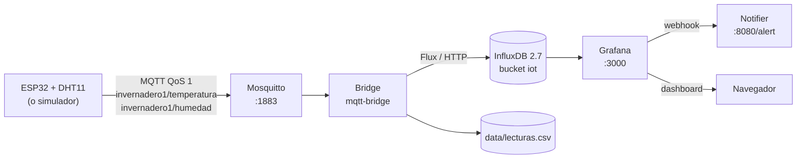

# IA for IoT — Monitoreo de confort térmico y respiratorio


Servidor web que recibe en tiempo real las lecturas de **temperatura y humedad**
de un **ESP32 con sensor DHT11**, las evalúa contra los rangos de confort de un
**cuarto de bebé** y las almacena **simultáneamente en SQLite y en un archivo CSV**.
Incluye panel web con gráficos, API REST documentada, simulador del dispositivo
y despliegue automático en un **servidor Ubuntu**.

> **¿Solo quieres verlo funcionando?** Tres comandos:
>
> ```powershell
> git clone https://github.com/juano2024/IA_for_IoT.git
> cd IA_for_IoT
> powershell -ExecutionPolicy Bypass -File .\scripts\setup.ps1
> ```
>
> ```bash
> git clone https://github.com/juano2024/IA_for_IoT.git
> cd IA_for_IoT
> chmod +x scripts/setup.sh && ./scripts/setup.sh
> ```
>
> Al terminar: <http://127.0.0.1:8080>

---

## Índice

1. [Qué hace el proyecto](#1-qué-hace-el-proyecto)
2. [Requisitos](#2-requisitos)
3. [Instalación paso a paso](#3-instalación-paso-a-paso)
4. [Verificación](#4-verificación)
5. [Conectar el ESP32](#5-conectar-el-esp32)
6. [Referencia de la API](#6-referencia-de-la-api)
7. [Datos y persistencia](#7-datos-y-persistencia)
8. [Configuración](#8-configuración)
9. [Comandos del día a día](#9-comandos-del-día-a-día)
10. [Solución de problemas](#10-solución-de-problemas)
11. [Estructura del repositorio](#11-estructura-del-repositorio)
12. [Pruebas y calidad](#12-pruebas-y-calidad)
13. [Checklist de entrega](#13-checklist-de-entrega)
14. [Práctica 2: MQTT, InfluxDB y Grafana](#14-práctica-2-mqtt-influxdb-y-grafana)

---

## 1. Qué hace el proyecto

### 1.1 Flujo de datos

```
┌──────────────┐   Wi-Fi (HTTP POST JSON)   ┌──────────────────────────────┐
│  ESP32       │ ─────────────────────────► │  Servidor Ubuntu            │
│  + DHT11     │                            │  ┌────────────────────────┐ │
│  GPIO 33     │ ◄───────────────────────── │  │ FastAPI (contenedor)   │ │
└──────────────┘        HTTP 201            │  │  • valida el JSON      │ │
                                            │  │  • clasifica OK/ALERTA │ │
┌──────────────┐        HTTP GET            │  │  • guarda en 2 sitios  │ │
│  Navegador   │ ◄────────────────────────► │  └───────────┬────────────┘ │
│  panel web   │                            │              │              │
└──────────────┘                            │      ┌───────┴────────┐     │
                                            │      ▼                ▼     │
                                            │  SQLite            CSV      │
                                            │  lecturas.db       lecturas │
                                            └──────────────────────────────┘
```

1. El ESP32 lee el DHT11 cada 10 segundos y envía un `POST /api/lecturas`.
2. El servidor valida el cuerpo, calcula el estado (`OK` o `ALERTA`) y el motivo.
3. La lectura se guarda **a la vez** en la base de datos SQLite y en el CSV.
4. El panel web (<http://127.0.0.1:8080>) consulta las últimas lecturas y dibuja
   el histórico con la banda de confort resaltada.

### 1.2 Caso de uso

Monitoreo de un **cuarto de bebé**. Los rangos de confort son configurables:

| Magnitud | Rango de confort | Fuera de rango |
|---|---|---|
| Temperatura | 18 °C – 22 °C | `< 18` o `> 22` |
| Humedad relativa | 40 % – 60 % | `< 40` o `> 60` |

Cada lectura se clasifica como:

| Estado | `alerta` | `motivo` |
|---|---|---|
| `OK` | `false` | `null` |
| `ALERTA` | `true` | Texto con las magnitudes fuera de rango |

Ejemplo de motivo: `temperatura por encima de 22 C; humedad por debajo de 40 %`.

### 1.3 Arquitectura de despliegue

El proyecto soporta **tres formas de ejecución** con el mismo código:

| Ruta | Qué hace | Cuándo usarla |
|---|---|---|
| **Docker directo** | Contenedor en el propio equipo | Linux/macOS; es la más portable |
| **Vagrant + VirtualBox** | VM Ubuntu 22.04 con Docker dentro | Windows; cumple "servidor Ubuntu" de forma literal |
| **Nativo con uv** | Python local, sin contenedor | Desarrollo y depuración |

Con **Docker** y **Vagrant** la API queda siempre en **`http://127.0.0.1:8080`**.
Con la ejecución nativa (`uv run ia-for-iot`) escucha en el **8000**.

### 1.4 Qué se guarda

Cada lectura genera **dos registros**:

- **SQLite** (`data/ia_for_iot.db`): tabla `lecturas` con `timestamp`, `dispositivo`,
  `temperatura_c`, `humedad_pct`, `estado`, `alerta`, `motivo`. Permite consultas.
- **CSV** (`data/lecturas.csv`): una fila por lectura, sin `motivo`. Fácil de abrir
  en Excel o de entregar como evidencia.

---

## 2. Requisitos

### 2.1 Matriz de compatibilidad

| Sistema | Ruta recomendada | Notas |
|---|---|---|
| **Windows 10/11** | Vagrant + VirtualBox | Es la ruta probada y documentada al detalle |
| **Ubuntu / Debian** | Docker directo | El propio equipo ya es el "servidor Linux" |
| **macOS (Intel)** | Docker o Vagrant | Ambas funcionan |
| **macOS (Apple Silicon)** | Docker | VirtualBox tiene soporte limitado en ARM |

> **Requisito de hardware:** 4 GB de RAM libres y ~5 GB de disco para la VM.
> La virtualización debe estar activada en la BIOS/UEFI.

### 2.2 Qué ruta elegir

- **No quieres complicarte y usas Windows** → Ruta automática con `setup.ps1`
  (instala todo y levanta la VM Ubuntu).
- **Usas Linux o macOS y ya tienes Docker** → `./scripts/setup.sh --docker`.
- **Solo quieres tocar el código** → `uv sync` y `uv run ia-for-iot`.

### 2.3 Instalar los requisitos

> **No necesitas instalar Python.** `uv` descarga Python 3.14 automáticamente
> la primera vez que ejecutas `uv sync`.

#### Windows 10/11

Abre **PowerShell** (no hace falta ser administrador; el script pedirá UAC
solo cuando instale VirtualBox).

```powershell
# 1. Git (si no lo tienes)
winget install --id Git.Git -e --accept-package-agreements --accept-source-agreements

# 2. Los demás requisitos los instala el script automáticamente:
#    uv, VirtualBox 7.2+, Vagrant y Arduino CLI.
```

Si prefieres instalarlos a mano:

```powershell
winget install --id astral-sh.uv -e --accept-package-agreements --accept-source-agreements
winget install --id Oracle.VirtualBox -e --accept-package-agreements --accept-source-agreements
winget install --id Hashicorp.Vagrant -e --accept-package-agreements --accept-source-agreements
winget install --id ArduinoSA.CLI -e --accept-package-agreements --accept-source-agreements
```

Cierra y vuelve a abrir PowerShell después de instalar para refrescar el `PATH`.

#### macOS

```bash
# Homebrew (si no lo tienes): https://brew.sh
brew install uv
brew install --cask docker            # Docker Desktop (ruta recomendada en Mac)
# Opcional, solo si usarás Vagrant:
brew install --cask virtualbox
brew install hashicorp/tap/hashicorp-vagrant
# Opcional, para el ESP32:
brew install arduino-cli
```

#### Linux (Ubuntu / Debian)

```bash
# uv
curl -LsSf https://astral.sh/uv/install.sh | sh
export PATH="$HOME/.local/bin:$PATH"

# Docker Engine + Compose (script oficial)
curl -fsSL https://get.docker.com | sudo sh
sudo usermod -aG docker "$USER"
newgrp docker          # o cierra sesión y vuelve a entrar

# Opcional, para el ESP32 (instalador oficial)
curl -fsSL https://raw.githubusercontent.com/arduino/arduino-cli/master/install.sh \
  | BINDIR="$HOME/.local/bin" sh
export PATH="$HOME/.local/bin:$PATH"
```

Si además quieres la ruta Vagrant en Linux:

```bash
# VirtualBox 7.2+ : el paquete de Ubuntu es la 6.1 y NO es compatible con
# Vagrant 2.4. Descárgalo de https://www.virtualbox.org/wiki/Linux_Downloads
# (o añade el repositorio oficial de Oracle).

# Vagrant desde el repositorio oficial de HashiCorp:
wget -O- https://apt.releases.hashicorp.com/gpg | \
  sudo gpg --dearmor -o /usr/share/keyrings/hashicorp-archive-keyring.gpg
echo "deb [signed-by=/usr/share/keyrings/hashicorp-archive-keyring.gpg] \
https://apt.releases.hashicorp.com $(lsb_release -cs) main" | \
  sudo tee /etc/apt/sources.list.d/hashicorp.list
sudo apt-get update && sudo apt-get install -y vagrant
```

---

## 3. Instalación paso a paso

### 3.1 Ruta automática (recomendada)

El script hace **todo** y es **idempotente** (puedes ejecutarlo varias veces).

#### Windows (PowerShell)

```powershell
git clone https://github.com/juano2024/IA_for_IoT.git
cd IA_for_IoT
powershell -ExecutionPolicy Bypass -File .\scripts\setup.ps1
```

Opciones:

```powershell
.\scripts\setup.ps1 -SinArduino      # sin Arduino CLI / core ESP32
.\scripts\setup.ps1 -SoloVerificar   # solo comprueba, no instala ni levanta
```

**Qué verás:**

```
[1/6] Entorno de Python (uv)
     OK  uv 0.12.2
     OK  Dependencias instaladas en .venv
[2/6] VirtualBox (hipervisor)
     OK  VirtualBox 7.2.22
[3/6] Vagrant (gestor de la maquina virtual)
     OK  Vagrant 2.4.9
[4/6] Imagen base Ubuntu 22.04
     OK  Box ubuntu/jammy64 ya descargada
[5/6] Servidor Ubuntu con Docker (vagrant up)
     OK  API respondiendo: estado=ok, lecturas=0
[6/6] Entorno de Arduino para el ESP32
     OK  Firmware compila correctamente
```

La primera ejecución tarda **10–20 minutos** (descarga la box de Ubuntu y
construye la imagen). Las siguientes son de segundos.

#### macOS / Linux (bash)

```bash
git clone https://github.com/juano2024/IA_for_IoT.git
cd IA_for_IoT
chmod +x scripts/setup.sh
./scripts/setup.sh
```

Opciones:

```bash
./scripts/setup.sh --docker        # fuerza Docker directo
./scripts/setup.sh --vagrant       # fuerza VM con Vagrant
./scripts/setup.sh --verificar     # solo comprueba el estado
./scripts/setup.sh --sin-arduino   # sin entorno de Arduino
```

El script elige automáticamente Docker si está disponible; si no, usa Vagrant.

### 3.2 Ruta manual A — VM Ubuntu con Vagrant (Windows/Linux)

Usa esta ruta si quieres ver el paso a paso que ejecuta el script.

**Paso 1 — Clonar el repositorio**

```powershell
git clone https://github.com/juano2024/IA_for_IoT.git
cd IA_for_IoT
```

**Paso 2 — Instalar dependencias de Python**

```powershell
uv sync
```

Esto crea `.venv`, descarga Python 3.14 si hace falta e instala FastAPI,
SQLAlchemy, pytest y Ruff.

**Paso 3 — Descargar la imagen base de Ubuntu**

```powershell
vagrant box add ubuntu/jammy64 --provider virtualbox
```

Solo la primera vez (~600 MB).

**Paso 4 — Crear la VM y desplegar el servidor**

```powershell
vagrant up
```

Esto, en una sola orden:

1. Crea la VM Ubuntu 22.04 (`ia_for_iot_server`).
2. Instala **Docker Engine** y el plugin de Compose dentro de la VM.
3. Copia el proyecto a `/home/vagrant/app`.
4. Construye la imagen y levanta el contenedor `ia_for_iot_api`.
5. Espera a que `/api/health` responda.

**Paso 5 — Abrir el panel**

<http://127.0.0.1:8080>

### 3.3 Ruta manual B — Docker directo (Linux/macOS)

```bash
git clone https://github.com/juano2024/IA_for_IoT.git
cd IA_for_IoT
uv sync                       # opcional: solo para el simulador y las pruebas
docker compose up -d --build
```

Verificar:

```bash
curl -s http://127.0.0.1:8080/api/health
```

Detener:

```bash
docker compose down           # elimina el contenedor; los datos siguen en ./data
```

> En Linux sin `sudo` para Docker, añade tu usuario al grupo:
> `sudo usermod -aG docker $USER` y vuelve a iniciar sesión.

### 3.4 Ruta manual C — Desarrollo nativo (sin contenedor)

```bash
uv sync
uv run ia-for-iot
```

El servidor escucha en **<http://127.0.0.1:8000>** (no 8080). Los datos se
escriben en `./data/`.

```bash
# En otra terminal: enviar lecturas simuladas
uv run simular-esp32 --url http://127.0.0.1:8000/api/lecturas --count 20 --interval 1
```

> En esta ruta los umbrales y las rutas se leen del archivo `.env`
> (copia `.env.example` a `.env`).

### 3.5 Qué hace el script por dentro

| Paso | `setup.ps1` (Windows) | `setup.sh` (macOS/Linux) |
|---|---|---|
| 1 | Instala `uv` con winget y ejecuta `uv sync` | Instala `uv` (brew o script oficial) y ejecuta `uv sync` |
| 2 | Instala/valida VirtualBox ≥ 7.2 | Elige Docker o Vagrant según lo disponible |
| 3 | Instala/valida Vagrant y avisa si Hyper-V está activo | Descarga la box de Ubuntu si usa Vagrant |
| 4 | Descarga la box `ubuntu/jammy64` | Levanta el servidor (`compose up` o `vagrant up`) |
| 5 | Ejecuta `vagrant up` y espera `/api/health` | Verifica `/api/health` |
| 6 | Instala Arduino CLI, core ESP32 y DHT; compila | Instala Arduino CLI, core ESP32 y DHT; compila |

---

## 4. Verificación

### 4.1 Checklist

Ejecuta estas comprobaciones en orden. Todas deben pasar.

```powershell
# Windows
Invoke-RestMethod http://127.0.0.1:8080/api/health | ConvertTo-Json -Depth 4
```

```bash
# macOS / Linux
curl -s http://127.0.0.1:8080/api/health | python3 -m json.tool
```

Respuesta esperada:

```json
{
  "estado": "ok",
  "version": "0.1.0",
  "total_lecturas": 0,
  "ultima_lectura": null,
  "base_de_datos": "ok",
  "csv": "/app/data/lecturas.csv"
}
```

| # | Comprobación | Resultado esperado |
|---|---|---|
| 1 | <http://127.0.0.1:8080/> | Panel con el gráfico |
| 2 | <http://127.0.0.1:8080/docs> | Swagger UI con todos los endpoints |
| 3 | `GET /api/health` | `"estado": "ok"` |
| 4 | Simulador (sección 4.2) | `HTTP 201` por cada lectura |
| 5 | `data/lecturas.csv` | Existe y crece |
| 6 | <http://127.0.0.1:8080/api/lecturas> | Lista JSON de lecturas |

### 4.2 Probar con el simulador (sin hardware)

El simulador genera lecturas realistas, con excursiones ocasionales fuera de rango:

```powershell
# Windows
uv run simular-esp32 --url http://127.0.0.1:8080/api/lecturas --count 20 --interval 2
```

```bash
# macOS / Linux
uv run simular-esp32 --url http://127.0.0.1:8080/api/lecturas --count 20 --interval 2
```

Salida esperada:

```
Simulador ESP32 -> http://127.0.0.1:8080/api/lecturas (intervalo 2.0s)
[12:00:01] {'dispositivo': 'esp32-dht11', 'temperatura_c': 21.05, 'humedad_pct': 48.3} -> HTTP 201
[12:00:03] {'dispositivo': 'esp32-dht11', 'temperatura_c': 24.61, 'humedad_pct': 44.1} -> HTTP 201
...
Simulador finalizado: 20 lecturas enviadas.
```

Parámetros:

| Parámetro | Por defecto | Descripción |
|---|---|---|
| `--url` | `http://127.0.0.1:8000/api/lecturas` | Endpoint de recepción |
| `--count` | `0` (infinito) | Número de lecturas a enviar |
| `--interval` | `10` | Segundos entre lecturas |
| `--api-key` | vacío | Cabecera `X-API-Key` si el servidor la exige |

### 4.3 Exportar los datos a Windows

Con la ruta Vagrant, el CSV está accesible por HTTP y la base SQLite vive dentro
de la VM. El script descarga ambos a la carpeta `data\` del proyecto:

```powershell
.\scripts\exportar_datos.ps1
```

```
CSV descargado  -> data\lecturas.csv (21 lineas)
SQLite descargado -> data\ia_for_iot.db
```

---

## 5. Conectar el ESP32

### 5.1 Cableado

| DHT11 | ESP32 | Nota |
|---|---|---|
| VCC (pin 1) | **3.3V** | No uses 5 V |
| DATA (pin 2) | **GPIO 33** | **Requiere pull-up externo de 10 kΩ a 3.3V** |
| GND (pin 4) | **GND** | — |

> **Importante:** el GPIO 33 del ESP32 es *solo entrada* y **no tiene pull-up
> interno**. Sin la resistencia de 10 kΩ entre DATA y 3.3 V el sensor devuelve
> `NaN` o valores erráticos. Es la causa número uno de fallos.

```
DHT11                ESP32
┌─────┐
│ VCC ├────────────── 3.3V
│     │
│ DATA├──┬─────────── GPIO 33
│     │  │
│     │  └──[10 kΩ]── 3.3V
│ GND ├────────────── GND
└─────┘
```

### 5.2 Editar el sketch

Abre `firmware/esp32_dht11/esp32_dht11.ino` y cambia las tres primeras constantes:

```cpp
#define WIFI_SSID   "TU_NOMBRE_WIFI"
#define WIFI_PASS   "TU_CLAVE_WIFI"
#define SERVER_URL  "http://192.168.1.100:8080"   // IP LAN del PC que corre la VM
```

**Cómo obtener la IP LAN del PC:**

| Sistema | Comando |
|---|---|
| Windows | `ipconfig` → *Dirección IPv4* del adaptador Wi-Fi |
| macOS | `ipconfig getifaddr en0` |
| Linux | `hostname -I` |

> El ESP32 y el PC deben estar en **la misma red Wi-Fi**. La IP `127.0.0.1`
> no sirve: desde el ESP32 apunta al propio ESP32.

**Abrir el puerto 8080 en el firewall del PC:**

```powershell
# Windows (PowerShell como administrador)
New-NetFirewallRule -DisplayName "IA for IoT - API 8080" `
  -Direction Inbound -Protocol TCP -LocalPort 8080 -Action Allow -Profile Any
```

```bash
# Linux con ufw
sudo ufw allow 8080/tcp
```

En macOS, acepta el aviso "¿Permitir conexiones entrantes?" la primera vez.

**Opcional — exigir clave al dispositivo:** define `DEVICE_API_KEY` en `.env`,
reinicia el servidor y pon el mismo valor en `#define API_KEY "..."`.

### 5.3 Compilar y cargar con Arduino CLI

```bash
# 1. Configurar el soporte de placas ESP32 (solo la primera vez)
arduino-cli config init
arduino-cli config add board_manager.additional_urls \
  https://espressif.github.io/arduino-esp32/package_esp32_index.json
arduino-cli core update-index
arduino-cli core install esp32:esp32

# 2. Instalar la librería del sensor (solo la primera vez)
arduino-cli lib install "DHT sensor library"

# 3. Averiguar el puerto
arduino-cli board list
#   Windows: COM3, COM4...   macOS: /dev/cu.usbserial-*   Linux: /dev/ttyUSB0

# 4. Compilar
arduino-cli compile --fqbn esp32:esp32:esp32 firmware/esp32_dht11

# 5. Cargar (sustituye COM3 por tu puerto)
arduino-cli upload --fqbn esp32:esp32:esp32 -p COM3 firmware/esp32_dht11

# 6. Ver los mensajes del dispositivo
arduino-cli monitor -p COM3 -c baudrate=115200
```

En Windows, si `arduino-cli` no está en el `PATH`, usa la ruta completa:

```powershell
& "C:\Program Files\Arduino CLI\arduino-cli.exe" upload `
  --fqbn esp32:esp32:esp32 -p COM3 firmware\esp32_dht11
```

**Salida esperada en el monitor serie:**

```
=== IA for IoT - ESP32 + DHT11 ===
Conectando a Wi-Fi....
Wi-Fi conectado. IP: 192.168.1.42
Temperatura: 21.40 C | Humedad: 49.00 %
HTTP 201 -> {"id":1,"timestamp":"...","estado":"OK","alerta":false,...}
```

> Si el ESP32 no aparece en `board list`, instala el driver del chip USB:
> **CP210x** (placas con CP2102) o **CH340** (clones). Reinicia y vuelve a probar.

### 5.4 Alternativa: Arduino IDE

1. **Archivo → Preferencias → Gestor de tarjetas adicionales**:
   `https://espressif.github.io/arduino-esp32/package_esp32_index.json`
2. **Herramientas → Placa → Gestor de tarjetas**: instala *ESP32 by Espressif Systems*.
3. **Herramientas → Gestionar bibliotecas**: instala *DHT sensor library* (Adafruit).
4. Abre `firmware/esp32_dht11/esp32_dht11.ino`, edita Wi-Fi y `SERVER_URL`.
5. Selecciona **ESP32 Dev Module** y el puerto correcto.
6. Pulsa **Subir** (flecha →).

### 5.5 Verificar que llegan los datos

```bash
curl -s "http://127.0.0.1:8080/api/lecturas?limite=5"
```

En el panel verás el punto nuevo cada 10 segundos y el contador de lecturas
aumentando en `/api/health`.

---

## 6. Referencia de la API

Documentación interactiva: **<http://127.0.0.1:8080/docs>**

### 6.1 Endpoints

| Método | Ruta | Descripción |
|---|---|---|
| `GET` | `/` | Panel web con gráficos |
| `POST` | `/api/lecturas` | Registra una lectura (201) |
| `GET` | `/api/lecturas?limite=100&dispositivo=esp32-dht11` | Histórico, más reciente primero |
| `GET` | `/api/lecturas/recientes?limite=60` | Últimas lecturas para el panel |
| `GET` | `/api/estadisticas?ventana=100` | Mín., máx., promedio y % fuera de rango |
| `GET` | `/api/lecturas.csv` | Descarga el CSV |
| `GET` | `/api/umbrales` | Rangos de confort activos |
| `GET` | `/api/health` | Estado del servicio y de la BD |
| `GET` | `/docs` | Swagger UI |

### 6.2 Ejemplos

**Registrar una lectura (PowerShell):**

```powershell
$cuerpo = @{
    dispositivo   = "esp32-dht11"
    temperatura_c = 21.4
    humedad_pct   = 49.0
} | ConvertTo-Json

Invoke-RestMethod -Method Post -Uri http://127.0.0.1:8080/api/lecturas `
  -ContentType "application/json" -Body $cuerpo
```

**Registrar una lectura (bash):**

```bash
curl -X POST http://127.0.0.1:8080/api/lecturas \
  -H "Content-Type: application/json" \
  -d '{"dispositivo":"esp32-dht11","temperatura_c":21.4,"humedad_pct":49.0}'
```

Respuesta:

```json
{
  "id": 1,
  "timestamp": "2026-10-22T15:04:05Z",
  "dispositivo": "esp32-dht11",
  "temperatura_c": 21.4,
  "humedad_pct": 49.0,
  "estado": "OK",
  "alerta": false,
  "motivo": null
}
```

**Cuerpo aceptado por `POST /api/lecturas`:**

| Campo | Tipo | Obligatorio | Validación |
|---|---|---|---|
| `dispositivo` | texto | no (por defecto `esp32-dht11`) | 1–64 caracteres |
| `temperatura_c` | número | **sí** | entre -40 y 80 |
| `humedad_pct` | número | **sí** | entre 0 y 100 |
| `timestamp` | ISO 8601 | no | si se omite, usa la hora del servidor |

Un cuerpo inválido devuelve **422** con el detalle del campo.

### 6.3 Seguridad opcional

Por defecto la API es abierta. Para exigir una clave:

```bash
# .env
DEVICE_API_KEY=mi-clave-secreta
```

```bash
curl -X POST http://127.0.0.1:8080/api/lecturas \
  -H "X-API-Key: mi-clave-secreta" \
  -H "Content-Type: application/json" \
  -d '{"temperatura_c":21,"humedad_pct":50}'
```

Sin la cabecera correcta, `POST /api/lecturas` devuelve **401**. Las lecturas
(`GET`) siguen siendo públicas.

---

## 7. Datos y persistencia

### 7.1 CSV

```csv
timestamp,dispositivo,temperatura_c,humedad_pct,estado,alerta
2026-10-22T15:04:05Z,esp32-dht11,21.40,49.00,OK,false
2026-10-22T15:04:15Z,esp32-dht11,24.10,38.00,ALERTA,true
```

- Se crea solo en la primera lectura.
- Se añade una fila por lectura (nunca se reescribe).
- `alerta` se escribe como `true` / `false` literal.

### 7.2 SQLite

Tabla `lecturas`:

| Columna | Tipo | Notas |
|---|---|---|
| `id` | INTEGER | Clave primaria autoincremental |
| `timestamp` | DATETIME | UTC, indexado |
| `dispositivo` | VARCHAR(64) | Indexado |
| `temperatura_c` | FLOAT | — |
| `humedad_pct` | FLOAT | — |
| `estado` | VARCHAR(16) | `OK` / `ALERTA` |
| `alerta` | BOOLEAN | — |
| `motivo` | VARCHAR(255) | `NULL` si está en rango |

Consultas útiles:

```bash
sqlite3 data/ia_for_iot.db "SELECT estado, COUNT(*) FROM lecturas GROUP BY estado;"
sqlite3 data/ia_for_iot.db "SELECT * FROM lecturas ORDER BY timestamp DESC LIMIT 10;"
sqlite3 data/ia_for_iot.db "SELECT ROUND(AVG(temperatura_c),2) FROM lecturas;"
```

### 7.3 Dónde viven los datos

| Ruta de ejecución | CSV | SQLite |
|---|---|---|
| Docker directo | `./data/lecturas.csv` | `./data/ia_for_iot.db` |
| Vagrant (dentro de la VM) | `/home/vagrant/app/data/lecturas.csv` | `/home/vagrant/app/data/ia_for_iot.db` |
| Nativo (`uv run`) | `./data/lecturas.csv` | `./data/ia_for_iot.db` |

Los datos **sobreviven** a `vagrant halt`, `docker compose down` y a la
reconstrucción de la imagen. Solo se pierden con `vagrant destroy` o borrando
la carpeta `data/`.

---

## 8. Configuración

### 8.1 Variables de entorno

Copia `.env.example` a `.env`:

```powershell
Copy-Item .env.example .env      # Windows
```

```bash
cp .env.example .env             # macOS / Linux
```

| Variable | Por defecto | Descripción |
|---|---|---|
| `APP_HOST` | `0.0.0.0` | Interfaz de escucha |
| `APP_PORT` | `8000` | Puerto interno (nativo) |
| `DATABASE_URL` | `sqlite:///./data/ia_for_iot.db` | Conexión SQLAlchemy |
| `CSV_PATH` | `./data/lecturas.csv` | Ruta del CSV |
| `TEMP_MIN` / `TEMP_MAX` | `18` / `22` | Rango de temperatura |
| `HUM_MIN` / `HUM_MAX` | `40` / `60` | Rango de humedad |
| `DEVICE_API_KEY` | vacío | Si se define, exige `X-API-Key` |

Con Docker/Vagrant, `TEMP_*`, `HUM_*` y `DEVICE_API_KEY` se aplican
automáticamente desde `.env`.

### 8.2 Cambiar los umbrales

1. Edita `.env` (o crea uno a partir de `.env.example`).
2. Reinicia el servidor:

```powershell
vagrant provision                 # ruta Vagrant
docker compose up -d --build      # ruta Docker
```

3. Comprueba el cambio:

```bash
curl -s http://127.0.0.1:8080/api/umbrales
```

> Los umbrales solo afectan a las lecturas **nuevas**; las anteriores conservan
> el estado con el que se guardaron.

### 8.3 Cambiar el puerto

- **Docker:** en `docker-compose.yml`, cambia `"8080:8000"` por `"9090:8000"`.
- **Vagrant:** en `Vagrantfile`, cambia `host: 8080` por `host: 9090` y ejecuta
  `vagrant reload`.

---

## 9. Comandos del día a día

| Acción | Windows (PowerShell) | macOS / Linux |
|---|---|---|
| Levantar el servidor | `vagrant up` | `docker compose up -d --build` |
| Detener | `vagrant halt` | `docker compose down` |
| Ver estado | `vagrant status` | `docker compose ps` |
| Entrar en la VM | `vagrant ssh` | — |
| Ver logs | `vagrant ssh -c "cd app && docker compose logs -f api"` | `docker compose logs -f api` |
| Aplicar cambios al servidor | `.\scripts\sincronizar_vm.ps1` | `docker compose up -d --build` |
| Reaprovisionar desde cero | `vagrant reload --provision` | `docker compose up -d --build --force-recreate` |
| Destruir la VM | `vagrant destroy -f` | — |
| Exportar datos | `.\scripts\exportar_datos.ps1` | `curl -O http://127.0.0.1:8080/api/lecturas.csv` |
| Simulador | `uv run simular-esp32 --url http://127.0.0.1:8080/api/lecturas` | igual |
| Pruebas | `uv run pytest` | `uv run pytest` |
| Lint | `uv run ruff check .` | `uv run ruff check .` |
| Formato | `uv run ruff format --check .` | `uv run ruff format --check .` |

> **Nota:** `sincronizar_vm.ps1` copia el código del host a la VM y reconstruye
> el contenedor. Úsalo después de editar `src/`. No borra `data/`.

---

## 10. Solución de problemas

| Síntoma | Causa probable | Solución |
|---|---|---|
| `vagrant up` falla al arrancar la VM | Hyper-V/WSL2 activo (incompatible con VirtualBox) | Desactiva *Virtual Machine Platform*, `bcdedit /set hypervisorlaunchtype off` y reinicia |
| `VBoxManage: error` o versión incompatible | VirtualBox < 7.2 con Vagrant 2.4.9 | `winget upgrade --id Oracle.VirtualBox` y reinicia |
| El puerto 8080 está ocupado | Otro proceso lo usa | Cambia el puerto (sección 8.3) |
| `vagrant up` se queda en "Waiting for machine..." | La VM arrancó pero el provisioner falló | `vagrant ssh -c "sudo tail -50 /var/log/cloud-init-output.log"` |
| `Error response from daemon` al construir | Sin espacio o sin permisos en Docker | `docker system prune -a` y reintenta |
| El build falla por `README.md` | `.dockerignore` excluye el README y `pyproject.toml` lo referencia | Mantén `README.md` fuera de `.dockerignore` |
| El CSV no crece | El servidor corre en otra ruta o no llegan lecturas | Revisa `GET /api/health` y los logs |
| `data/` vacío tras reiniciar | Se lanzó `vagrant destroy` o se borró la carpeta | Es esperado: esos comandos borran datos |
| El ESP32 no conecta a Wi-Fi | Credenciales o red 5 GHz | Usa una red **2.4 GHz**, revisa SSID/clave |
| El ESP32 no llega al servidor | Firewall, IP equivocada o `127.0.0.1` | Usa la IP LAN del PC y abre el puerto 8080 |
| DHT11 devuelve `NaN` | Falta la resistencia pull-up de 10 kΩ | Añádela entre DATA y 3.3 V |
| `arduino-cli: command not found` | No está en el `PATH` | Usa la ruta completa o reinstala y reinicia la terminal |
| `board list` no muestra el ESP32 | Falta el driver USB (CP210x/CH340) | Instala el driver y prueba otro cable USB (de datos) |
| `Permission denied` con Docker en Linux | Usuario fuera del grupo `docker` | `sudo usermod -aG docker $USER` y reabre sesión |
| Error de `uv` al instalar Python 3.14 | Sin conexión o proxy | Revisa la red; `uv python install 3.14` |

**Comandos de diagnóstico:**

```powershell
vagrant status
vagrant ssh -c "docker ps -a"
vagrant ssh -c "cd app && docker compose logs --tail 80"
docker compose ps
docker compose logs --tail 80
```

```bash
docker compose ps
docker compose logs --tail 80 api
```

---

## 11. Estructura del repositorio

```
IA_for_IoT/
├── .env.example              # Plantilla de configuración
├── .gitignore                # Excluye .venv, data/, .env, .vagrant/
├── .python-version           # 3.14 (uv lo descarga solo)
├── pyproject.toml            # Dependencias, scripts y config de Ruff/pytest
├── uv.lock                   # Versiones exactas (reproducibilidad)
├── README.md                 # Este documento
├── actividad1.txt            # Enunciado original (versión Adafruit IO)
│
├── Vagrantfile               # VM Ubuntu: 2 GB RAM, 2 vCPU, puerto 8080
├── deploy/
│   └── provision.sh          # Instala Docker, copia el código y levanta el servicio
├── Dockerfile                # Imagen Python 3.14 + uv, usuario sin privilegios
├── docker-compose.yml        # Servicio api, volumen ./data y healthcheck
├── .dockerignore
│
├── src/ia_for_iot/
│   ├── __init__.py           # Entrypoint `ia-for-iot`
│   ├── api.py                # Rutas FastAPI y lifespan
│   ├── config.py             # Settings desde entorno/.env
│   ├── database.py           # Engine, sesiones y creación de tablas
│   ├── models.py             # Modelo ORM `Lectura`
│   ├── schemas.py            # Esquemas Pydantic de entrada/salida
│   ├── service.py            # Evaluación OK/ALERTA + registro
│   ├── storage.py            # Escritura del CSV
│   ├── simulador.py          # Entrypoint `simular-esp32`
│   └── static/index.html     # Panel web (Chart.js)
│
├── tests/
│   ├── test_api.py           # 11 pruebas de la API
│   └── test_mqtt_bridge.py   # 10 pruebas del puente MQTT
├── firmware/
│   ├── esp32_dht11/
│   │   └── esp32_dht11.ino       # Sketch HTTP de la Práctica 1
│   └── esp32_dht11_mqtt/
│       └── esp32_dht11_mqtt.ino  # Sketch MQTT de la Práctica 2
├── mqtt/                     # Stack de la Práctica 2
│   ├── docker-compose.yml    # Mosquitto + InfluxDB + Grafana + bridge + notifier
│   ├── mosquitto/            # Configuración y entrypoint con usuario/clave
│   ├── grafana/
│   │   ├── dashboards/       # Dashboard de confort (JSON)
│   │   └── provisioning/     # Datasource, dashboards y alertas
│   └── notifier/             # Receptor de webhooks de Grafana
└── scripts/
    ├── setup.ps1             # Instalación automática en Windows
    ├── setup.sh              # Instalación automática en macOS/Linux
    ├── mqtt_vm.ps1           # Despliega el stack MQTT en la VM
    ├── sincronizar_vm.ps1    # Copiar cambios a la VM y reconstruir
    └── exportar_datos.ps1    # Descargar CSV y SQLite
```

---

## 12. Pruebas y calidad

```bash
uv run pytest                     # 21 pruebas
uv run ruff check .               # Lint
uv run ruff format --check .      # Formato
```

Cobertura funcional de las pruebas:

- Lectura dentro de rango → `OK`, `alerta=false`, `motivo=null`.
- Lectura fuera de rango → `ALERTA` con ambos motivos.
- Rechazo de payload inválido → `422`.
- Histórico, estadísticas y promedios.
- Escritura real en el CSV (incluido `alerta` como `false`).
- Descarga del CSV y del panel web.
- `X-API-Key` obligatoria cuando `DEVICE_API_KEY` está definida.
- Interpretación de mensajes MQTT numéricos y JSON.
- Emparejamiento temperatura/humedad y descarte de pares incompletos por TTL.
- Construcción del punto de InfluxDB y de la fila del CSV.
- Evaluación de umbrales y persistencia doble (InfluxDB + CSV).

---

## 13. Checklist de entrega

- [ ] `git clone` del repositorio en un equipo limpio.
- [ ] `scripts/setup.ps1` (o `setup.sh`) termina sin errores.
- [ ] <http://127.0.0.1:8080> muestra el panel.
- [ ] <http://127.0.0.1:8080/docs> muestra la API.
- [ ] `GET /api/health` devuelve `"estado": "ok"`.
- [ ] El simulador envía lecturas y el panel se actualiza.
- [ ] `data/lecturas.csv` contiene las lecturas con `estado` y `alerta`.
- [ ] La tabla `lecturas` de SQLite contiene las mismas lecturas + `motivo`.
- [ ] El ESP32 físico envía lecturas cada 10 s (si hay hardware).
- [ ] `uv run pytest` → 21 aprobadas.
- [ ] `uv run ruff check .` y `ruff format --check .` → sin errores.
- [ ] `.\scripts\mqtt_vm.ps1` levanta los cinco contenedores de la Práctica 2.
- [ ] El bridge escribe lecturas en `data/lecturas.csv` y en InfluxDB.
- [ ] Grafana muestra el dashboard de confort y las cuatro alertas.
- [ ] Forzar 30 °C / 80 % dispara las alertas y el notificador las registra.

---

## 14. Práctica 2: MQTT, InfluxDB y Grafana

Esta práctica añade la ruta de telemetría industrial: el ESP32 publica en un
broker MQTT, un puente guarda cada lectura en InfluxDB y en el CSV, y Grafana
visualiza y alerta. Todo se levanta con Docker Compose dentro de la misma VM
de la Práctica 1 y se despliega en Google Cloud (sección 14.8).

Caso de uso: **condiciones de confort en un invernadero**. Rangos
óptimos: 15–30 °C y 60–80 % de humedad relativa (fuente: guías de cultivo).

### 14.1 Arquitectura



| Componente | Imagen | Puerto host | Función |
|---|---|---|---|
| `mosquitto` | `eclipse-mosquitto:2` | 1883 | Broker MQTT con usuario y contraseña |
| `influxdb` | `influxdb:2.7` | 8086 (en GCP no se publica) | Base de datos de series de tiempo (bucket `iot`) |
| `grafana` | `grafana/grafana-oss:11.6.0` | 3000 | Dashboards y alertas |
| `bridge` | `ia-for-iot:latest` | — | Suscribe `invernadero1/#` y escribe InfluxDB + CSV |
| `notifier` | `python:3.14-slim` | — | Recibe los webhooks de alerta y los registra |

### 14.2 Levantar el stack

```powershell
# Windows: arranca la VM, sincroniza el código y construye los contenedores
.\scripts\mqtt_vm.ps1

# Ver logs de todos los servicios
.\scripts\mqtt_vm.ps1 -Logs

# Apagar el stack
.\scripts\mqtt_vm.ps1 -Down
```

En Linux/macOS con Docker instalado (sin Vagrant):

```bash
docker compose -f mqtt/docker-compose.yml up -d --build
docker compose -f mqtt/docker-compose.yml logs -f bridge notifier
```

| Servicio | URL | Usuario | Contraseña |
|---|---|---|---|
| Grafana | <http://127.0.0.1:3000> | `admin` | `admin` |
| InfluxDB | <http://127.0.0.1:8086> | `admin` | `admin12345` |
| MQTT | `mqtt://127.0.0.1:1883` | `iot` | `iot2026` |

> Cambia estas credenciales en `.env` antes de exponer los puertos a Internet.

### 14.3 Topics y formato

| Topic | Payload | Ejemplo |
|---|---|---|
| `invernadero1/temperatura` | Número en texto | `22.40` |
| `invernadero1/humedad` | Número en texto | `51.30` |
| `invernadero1/sensores` | JSON (opcional) | `{"dispositivo":"esp32-dht11","temperatura_c":22.4,"humedad_pct":51.3}` |

El puente empareja `temperatura` y `humedad` recibidas en una ventana de
`MQTT_PAIR_TTL` segundos (60 por defecto) y descarta los pares incompletos.

### 14.4 Punto 4: almacenamiento en InfluxDB y CSV

Cada par de lecturas se guarda dos veces:

- **InfluxDB** (`measurement=clima`, bucket `iot`): campos `temperatura_c`,
  `humedad_pct` y `alerta` (0/1); etiquetas `dispositivo`, `sala` y `estado`.
- **CSV** (`data/lecturas.csv`):
  `timestamp,dispositivo,temperatura_c,humedad_pct,estado,alerta`.

Consulta Flux de ejemplo (dentro de la VM):

```bash
docker compose -f mqtt/docker-compose.yml exec influxdb \
  influx query 'from(bucket:"iot") |> range(start:-1h) |> last()' \
  --org iaforiot --token ia-for-iot-token
```

La retención del bucket es de 30 días.

### 14.5 Punto 5: visualización y alertas en Grafana

El provisioning automático crea:

- Datasource **InfluxDB IoT** (Flux, uid `influxdb-iot`).
- Dashboard **IA for IoT - Confort del invernadero** (uid `ia-iot-confort`):
  temperatura actual, humedad actual, estado de confort y dos series temporales
  con las bandas de confort, 15–30 °C y 60–80 %.
- Cuatro reglas de alerta (carpeta `IA for IoT`, evaluación cada 10 s):

| Alerta | Condición | Severidad |
|---|---|---|
| Temperatura alta | último valor > 30 °C | critical |
| Temperatura baja | último valor < 15 °C | critical |
| Humedad alta | último valor > 80 % | warning |
| Humedad baja | último valor < 60 % | warning |

Las consultas de las alertas y de los paneles agrupan por `dispositivo`
antes de tomar el último valor. Sin ese paso, la etiqueta `estado` separaba
los datos en una serie OK y otra ALERTA, y una alerta seguía disparada hasta
5 minutos después de normalizarse la lectura.

- Punto de contacto **Webhook notificador** → `http://notifier:8080/alert`.
  El notificador escribe cada aviso en `mqtt/notifier/data/notificaciones.log`
  y en la salida estándar del contenedor.

Prueba rápida de una alerta (fuerza 12 °C y 85 %):

```powershell
uv run simular-esp32-mqtt --host 127.0.0.1 --user iot --password iot2026 `
  --count 2 --interval 2 --temperatura 12 --humedad 85
```

En 10–30 s «Temperatura baja» y «Humedad alta» pasan a `firing` en
<http://127.0.0.1:3000/alerting/list> y el notificador registra `[FIRING:1]`.
Al enviar valores normales (`--temperatura 24 --humedad 70`) quedan en
`[RESOLVED]` en unos 30 s.

Notificaciones por correo (opcional): define `GRAFANA_SMTP_*` en `.env` y
añade un contact point de tipo email en Grafana.

### 14.6 Simulador MQTT

```bash
uv run simular-esp32-mqtt --host 127.0.0.1 --user iot --password iot2026 --count 20 --interval 1
uv run simular-esp32-mqtt --host 127.0.0.1 --user iot --password iot2026 --json --count 10
```

Opciones: `--temperatura` y `--humedad` fijan valores para probar alertas;
`--json` publica un único topic JSON; `--count 0` publica indefinidamente.

### 14.7 Firmware ESP32 (MQTT)

`firmware/esp32_dht11_mqtt/esp32_dht11_mqtt.ino` publica cada 10 s en
`invernadero1/temperatura` y `invernadero1/humedad`. Ajusta `WIFI_SSID`,
`WIFI_PASS`, `MQTT_HOST` (IP LAN del PC con Vagrant o IP externa de la VM en
Google Cloud) y las credenciales `MQTT_USER`/`MQTT_PASS`. Esos valores se
comparten por un canal privado; no se suben al repositorio.

```bash
arduino-cli lib install PubSubClient
arduino-cli compile --fqbn esp32:esp32:esp32 firmware/esp32_dht11_mqtt
arduino-cli upload -p COM3 --fqbn esp32:esp32:esp32 firmware/esp32_dht11_mqtt
```

### 14.8 Despliegue en Google Cloud

Los pasos completos están en [`ENTREGA_PRACTICA_2.md`](ENTREGA_PRACTICA_2.md),
sección 8. Un solo script crea todo:

```powershell
# Crear proyecto, IP estática, firewall y VM (claves nuevas en .env.gcp)
.\scripts\gcp_practica2.ps1 -Up -ProjectId ia-iot-p2-2026 -BillingAccount <ID>

# Ver el arranque y los contenedores (SSH por IAP)
.\scripts\gcp_practica2.ps1 -Status -ProjectId ia-iot-p2-2026

# Borrar el proyecto completo al terminar
.\scripts\gcp_practica2.ps1 -Down -ProjectId ia-iot-p2-2026
```

| Recurso | Configuración |
|---|---|
| VM | `e2-micro` (capa gratuita), Ubuntu 22.04, disco estándar de 20 GB, 2 GB de intercambio |
| IP | Externa estática; es la que va en `MQTT_HOST` del firmware |
| Firewall | 1883 y 3000 abiertos; SSH solo por IAP; **8086 cerrado** |
| Arranque | [`deploy/gcp_mqtt_startup.sh`](deploy/gcp_mqtt_startup.sh): instala Docker, clona la rama, escribe `mqtt/.env` desde los metadatos y levanta el stack |
| Override | [`mqtt/docker-compose.gcp.yml`](mqtt/docker-compose.gcp.yml): InfluxDB solo en la red interna de Docker y contraseñas obligatorias |

En la nube no se usan las credenciales por defecto de la tabla 14.2: el
script genera claves aleatorias en `.env.gcp` (ignorado por git).

> Mejoras para producción: MQTT con TLS (8883), proxy inverso con HTTPS para
> Grafana y un token de InfluxDB de solo lectura para Grafana.

### 14.9 Solución de problemas MQTT

| Síntoma | Causa probable | Solución |
|---|---|---|
| `No se pudo autenticar con el broker` | Faltan `--user/--password` | Añádelos o revisa `MQTT_USERNAME`/`MQTT_PASSWORD` |
| El bridge no registra lecturas | Topics no coinciden | Publica en `invernadero1/temperatura` y `/humedad` |
| Grafana muestra `DatasourceError` | Token u org incorrectos | Revisa `INFLUX_ORG`/`INFLUX_TOKEN` y reinicia Grafana |
| Alertas en `NoData` | Sin datos en los últimos 5 min | Envía lecturas nuevas con el simulador |
| `input data must be a wide series` | La consulta deja columnas de etiqueta sueltas | Usa `keep(...)` y `group(...)` antes de `last()`, como en `alert-rules.yml` |
| `docker compose` falla con `Define ... en mqtt/.env` | Falta una clave en el override de GCP | Copia `mqtt/.env.example` a `mqtt/.env` y complétalo |
| El dashboard no carga series | Variable `bucket` distinta de `iot` | Ajusta la variable o el bucket |

---

## Créditos

Laboratorio de **IA for IoT**. Enunciado original en `actividad1.txt`
(versión Adafruit IO); esta implementación sustituye la nube por un servidor
propio en Ubuntu con FastAPI, SQLite y CSV. La Práctica 2 añade Mosquitto,
InfluxDB y Grafana para la ruta MQTT.
